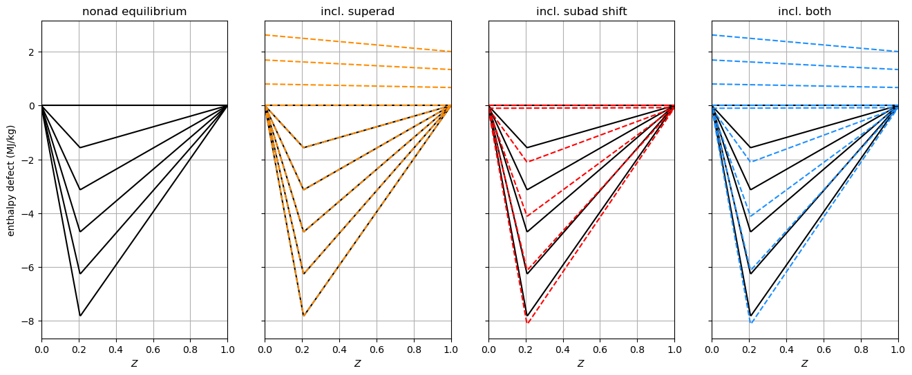
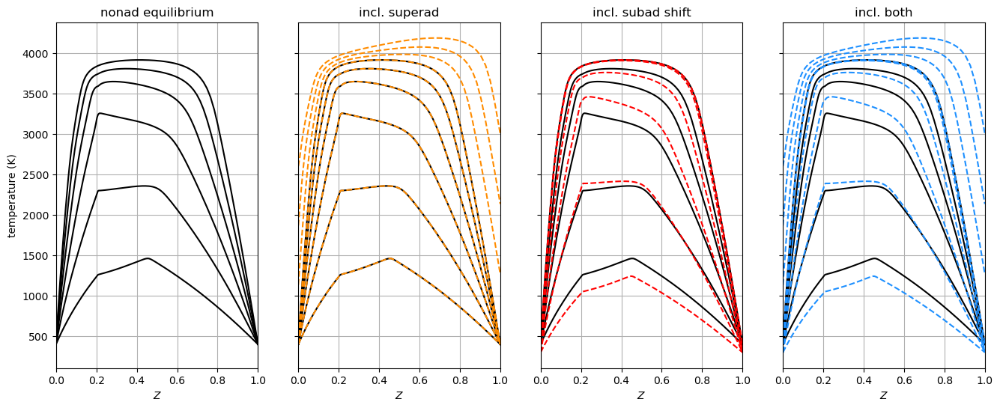
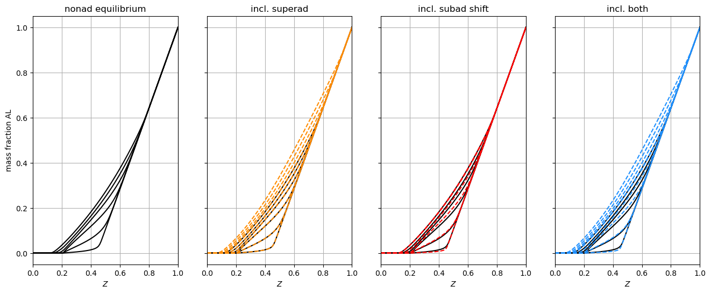
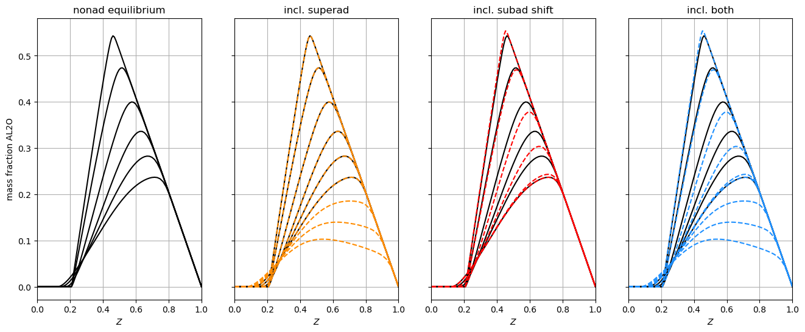
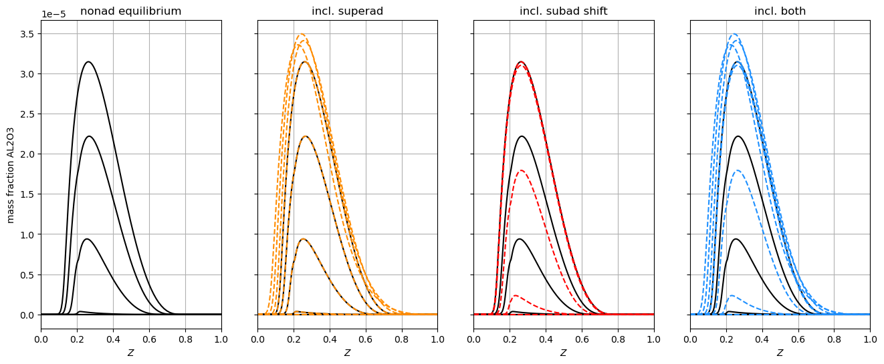
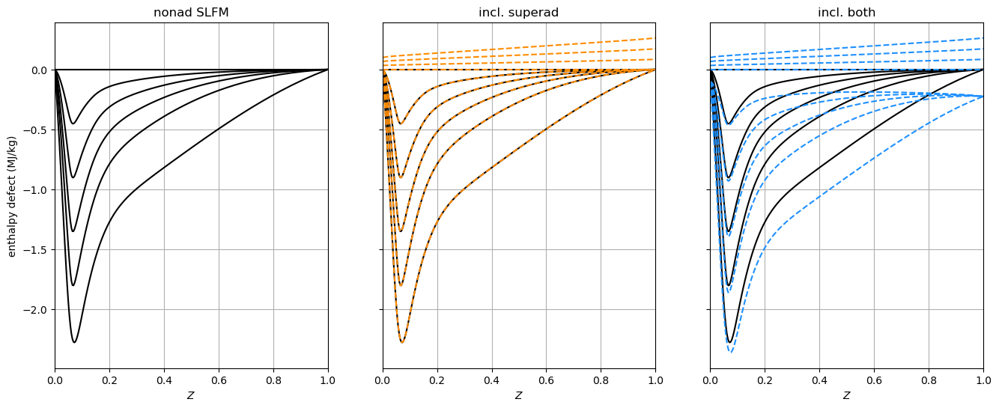
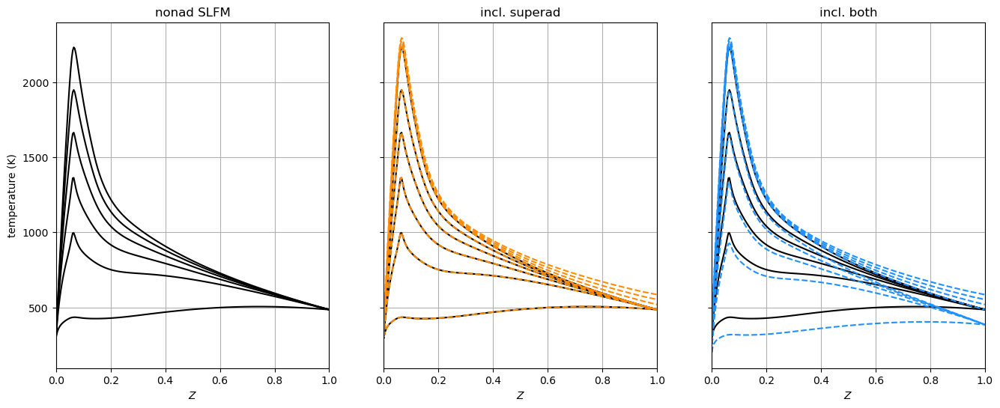

Tabulation API Example: Superadiabatic Flamelet Models
======================================================

*This demo is part of Spitfire, with* `licensing and copyright info
here. <https://github.com/sandialabs/Spitfire/blob/master/license.md>`__

*Highlights*

-  creating libraries with superadiabatic and/or subadiabatic states
   using ``build_nonadiabatic*`` methods in Spitfire
-  demonstrating aluminum chemistry nonadiabatic equilibrium

This example builds nonadiabatic flamelet models that include both
superadiabatic and subadiabatic states using heptane and aluminum
chemistry. It also demonstrates the use of a heatloss multiplier for
nonadiabatic equilibrium.

.. code:: ipython3

    from spitfire import (ChemicalMechanismSpec, 
                          FlameletSpec,
                          Library,
                          build_nonadiabatic_defect_eq_library, 
                          build_nonadiabatic_defect_transient_slfm_library)
    import matplotlib.pyplot as plt
    import numpy as np

Nonadiabatic equilibrium with aluminum chemistry
------------------------------------------------

Below we build four nonadiabatic equilibrum libraries with various
features turned on/off. All four use a ``stoich_heatloss_multiplier``
that helps expand the heatloss dimension of the table. This can be
useful for certain chemistries where the heat loss profile of the cooled
mixture is not similar to the presumed triangular profile peaking at
stoichiometric mixture fraction. Superadiabatic states can be added to
the library when specifying a nonzero ``superad_dT``. These states are
computed through raising the boundary temperatures and solving for
equilibrium. Subadiabatic states can also be shifted away from the
adiabatic state defined by the ``FlameletSpec`` class by providing a
nonzero ``subad_dT``. Fuel and oxidizer temperature differences can be
specified separately through a dictionary with ``'fuel'`` and ``'oxy'``
keys for both ``superad_dT`` and ``subad_dT``. The number of
stoichiometric enthalpy defect points added to the library is controlled
through n_defect_st. When including superadiabatic states, this must be
a dictionary with ``'n_subad'`` and ``'n_superad'`` keys controlling the
number of subadiabatic and superadiatic tabulation states, respectively.
The adiabatic state with zero stoichiometric enthalpy defect is always
included.

The first ‘nonad equilibrium’ library does not use any boundary
temperature shifts. The triangular enthalpy defect profiles have a
single degenerate point at a mixture fraction of zero and one. The
adiabatic state is defined by the horizontal line at enthalpy defect of
zero.

The second library ‘incl. superad’ adds 3 superadiabatic profiles to the
existing subadiabatic states of ‘nonad equilibrium’. These are the 3
linear profiles that exist at positive enthalpy defect. The fuel and
oxidizer temperatures are shifted by different amounts using a
dictionary for ``superad_dT``.

The third library ‘incl. subad shift’ shifts the fuel and oxidizer
temperatures (by the same amount ``subad_dT``\ =100 K) prior to
performing the subadiabatic solutions. The adiabatic state from ‘nonad
equilibrium’ still exists at enthalpy defect of zero, but the degenerate
points at the pure streams are shifted down relative to the adiabatic
state.

The fourth library ‘incl. both’ performs both the superadiabatic
solutions of ‘incl. superad’ and the shifted subadiabatic solutions of
‘incl. subad shift’.

.. code:: ipython3

    mech = ChemicalMechanismSpec(cantera_input='catoire_al2o3.yaml', group_name='gas')
    pressure = 101325.
    air = mech.stream(stp_air=True)
    air.TP = 400., pressure
    fuel = mech.stream('TPX', (400., pressure, 'Al:1'))
    flamelet_specs = FlameletSpec(mech_spec=mech, oxy_stream=air, fuel_stream=fuel, grid_points=128)
    
    stoich_heatloss_multiplier = 1.7
    subad_dT = 100.
    superad_dT = {'fuel':3000.-fuel.T, 'oxy':2600.-air.T}
    n_defect_st = {'n_subad':5, 'n_superad':3}
    
    l_eq = build_nonadiabatic_defect_eq_library(flamelet_specs, n_defect_st=n_defect_st['n_subad']+1, stoich_heatloss_multiplier=stoich_heatloss_multiplier, verbose=False)
    
    l_both = build_nonadiabatic_defect_eq_library(flamelet_specs, verbose=False, stoich_heatloss_multiplier=stoich_heatloss_multiplier,
                                                  n_defect_st=n_defect_st, superad_dT=superad_dT, subad_dT=subad_dT)
    
    l_superad = build_nonadiabatic_defect_eq_library(flamelet_specs, verbose=False, stoich_heatloss_multiplier=stoich_heatloss_multiplier,
                                                     n_defect_st=n_defect_st, superad_dT=superad_dT)
    
    l_subad = build_nonadiabatic_defect_eq_library(flamelet_specs, verbose=False, stoich_heatloss_multiplier=stoich_heatloss_multiplier,
                                                     n_defect_st=n_defect_st['n_subad']+1, subad_dT=subad_dT)

.. code:: ipython3

    c_orig = 'k'
    c_both = 'dodgerblue'
    c_sup = 'darkorange'
    c_sub = 'r'
    lw = 1.5
    
    prop = 'enthalpy_defect'
    scl = 1.e-6
    fig, axarray = plt.subplots(1, 4, sharex=True, sharey=True)
    for i in range(4):
        axarray[i].plot(l_eq.mixture_fraction_values, l_eq[prop] * scl, '-', linewidth=lw, color=c_orig)
    axarray[1].plot(l_superad.mixture_fraction_values, l_superad[prop] * scl, '--', linewidth=lw, color=c_sup)
    axarray[2].plot(l_subad.mixture_fraction_values, l_subad[prop] * scl, '--', linewidth=lw, color=c_sub)
    axarray[3].plot(l_both.mixture_fraction_values, l_both[prop] * scl, '--', linewidth=lw, color=c_both)
    
    axarray[0].set_ylabel('enthalpy defect (MJ/kg)')
    axarray[0].set_title('nonad equilibrium')
    axarray[1].set_title('incl. superad')
    axarray[2].set_title('incl. subad shift')
    axarray[3].set_title('incl. both')
    
    for ax in axarray:
        ax.set_xlim([0, 1])
        ax.grid()
        ax.set_xlabel('$Z$')
    fig.set_size_inches(16, 6)
    plt.show()
    
    
    prop = 'temperature'
    scl = 1.
    fig, axarray = plt.subplots(1, 4, sharex=True, sharey=True)
    for i in range(4):
        axarray[i].plot(l_eq.mixture_fraction_values, l_eq[prop] * scl, '-', linewidth=lw, color=c_orig)
    axarray[1].plot(l_superad.mixture_fraction_values, l_superad[prop] * scl, '--', linewidth=lw, color=c_sup)
    axarray[2].plot(l_subad.mixture_fraction_values, l_subad[prop] * scl, '--', linewidth=lw, color=c_sub)
    axarray[3].plot(l_both.mixture_fraction_values, l_both[prop] * scl, '--', linewidth=lw, color=c_both)
    
    axarray[0].set_ylabel('temperature (K)')
    axarray[0].set_title('nonad equilibrium')
    axarray[1].set_title('incl. superad')
    axarray[2].set_title('incl. subad shift')
    axarray[3].set_title('incl. both')
    
    for ax in axarray:
        ax.set_xlim([0, 1])
        ax.grid()
        ax.set_xlabel('$Z$')
    fig.set_size_inches(16, 6)
    plt.show()

.. code:: ipython3

    for species in ['AL','AL2O','AL2O3']:
        prop = f'mass fraction {species}'
        scl = 1.
        fig, axarray = plt.subplots(1, 4, sharex=True, sharey=True)
        for i in range(4):
            axarray[i].plot(l_eq.mixture_fraction_values, l_eq[prop] * scl, '-', linewidth=lw, color=c_orig)
        axarray[1].plot(l_superad.mixture_fraction_values, l_superad[prop] * scl, '--', linewidth=lw, color=c_sup)
        axarray[2].plot(l_subad.mixture_fraction_values, l_subad[prop] * scl, '--', linewidth=lw, color=c_sub)
        axarray[3].plot(l_both.mixture_fraction_values, l_both[prop] * scl, '--', linewidth=lw, color=c_both)
    
        axarray[0].set_ylabel(prop)
        axarray[0].set_title('nonad equilibrium')
        axarray[1].set_title('incl. superad')
        axarray[2].set_title('incl. subad shift')
        axarray[3].set_title('incl. both')
    
        for ax in axarray:
            ax.set_xlim([0, 1])
            ax.grid()
            ax.set_xlabel('$Z$')
        fig.set_size_inches(16, 6)
        plt.show()

Nonadiabatic SLFM with heptane chemistry
----------------------------------------

Superadiabatic and shifted subadiabatic states can also be added to
nonadiabatic SLFM libraries. Below we build three nonadiabatic SLFM
libraries with various features turned on/off. These features are
similar to those displayed for nonadiabatic equilibrium above, but
involve a third table dimension of stoichiometric dissipation rate. In
this example, we compute libraries for a single stoichiometric
dissipation rate so the plots are still two-dimensional. A second
difference compared to nonadiabatic equilibrium libraries, is that
nonadiabatic SLFM libraries are interpolated onto a structured grid for
the stoichiometric enthalpy defect dimension. This effect is shown in
the example below.

The first ‘nonad SLFM’ library does not use any boundary temperature
shifts. The smooth enthalpy defect profiles have a single degenerate
point at a mixture fraction of zero and one. The adiabatic state is
defined by the horizontal line at enthalpy defect of zero.

The second library ‘incl. superad’ adds 3 superadiabatic profiles to the
existing subadiabatic states of ‘nonad SLFM’. These are the 3 linear
profiles that exist at positive enthalpy defect. The fuel and oxidizer
temperatures are shifted by ``superad_dT``.

The third library ‘incl. both’ performs both superadiabatic solutions
and shifted subadiabatic solutions. Unlike the analogous equilibrium
table, the nonadiabatic states for SLFM get interpolated onto a
structured stoichiometric enthalpy defect dimension. This grid is
computed using the maximum observed enthalpy defect ranges (positive and
negative) relative to the adiabatic state and the ``'n_superad'`` and
``'n_subad'`` entries in the specified ``n_defect_st`` dictionary.

.. code:: ipython3

    mech = ChemicalMechanismSpec(cantera_input='heptane-liu-hewson-chen-pitsch-highT.yaml', group_name='gas')
    pressure = 101325.
    air = mech.stream(stp_air=True)
    fuel = mech.stream('TPX', (485., pressure, 'NXC7H16:1'))
    flamelet_specs = FlameletSpec(mech_spec=mech, oxy_stream=air, fuel_stream=fuel, grid_points=81)
    
    subad_dT = 100.
    superad_dT = 100.
    n_defect_st = {'n_subad':5, 'n_superad':3}
    chivals = np.array([1.e-2])
    
    l_slfm = Library.squeeze(build_nonadiabatic_defect_transient_slfm_library(flamelet_specs, verbose=False,
                                                                              diss_rate_values=chivals, n_defect_st=n_defect_st['n_subad']+1))
    
    l_slfm_superad = Library.squeeze(build_nonadiabatic_defect_transient_slfm_library(flamelet_specs, verbose=False,
                                                                                      diss_rate_values=chivals, n_defect_st=n_defect_st,
                                                                                      superad_dT=superad_dT))
    
    l_slfm_both = Library.squeeze(build_nonadiabatic_defect_transient_slfm_library(flamelet_specs, verbose=False,
                                                                                   diss_rate_values=chivals, n_defect_st=n_defect_st,
                                                                                   superad_dT=superad_dT, subad_dT=subad_dT))

.. code:: ipython3

    prop = 'enthalpy_defect'
    scl = 1.e-6
    fig, axarray = plt.subplots(1, 3, sharex=True, sharey=True)
    for i in range(3):
        axarray[i].plot(l_slfm.mixture_fraction_values, l_slfm[prop] * scl, '-', linewidth=lw, color=c_orig)
    axarray[1].plot(l_slfm_superad.mixture_fraction_values, l_slfm_superad[prop] * scl, '--', linewidth=lw, color=c_sup)
    axarray[2].plot(l_slfm_both.mixture_fraction_values, l_slfm_both[prop] * scl, '--', linewidth=lw, color=c_both)
    
    axarray[0].set_ylabel('enthalpy defect (MJ/kg)')
    axarray[0].set_title('nonad SLFM')
    axarray[1].set_title('incl. superad')
    axarray[2].set_title('incl. both')
    
    for ax in axarray:
        ax.set_xlim([0, 1])
        ax.grid()
        ax.set_xlabel('$Z$')
    fig.set_size_inches(16, 6)
    plt.show()
    
    
    prop = 'temperature'
    scl = 1.
    fig, axarray = plt.subplots(1, 3, sharex=True, sharey=True)
    for i in range(3):
        axarray[i].plot(l_slfm.mixture_fraction_values, l_slfm[prop] * scl, '-', linewidth=lw, color=c_orig)
    axarray[1].plot(l_slfm_superad.mixture_fraction_values, l_slfm_superad[prop] * scl, '--', linewidth=lw, color=c_sup)
    axarray[2].plot(l_slfm_both.mixture_fraction_values, l_slfm_both[prop] * scl, '--', linewidth=lw, color=c_both)
    
    axarray[0].set_ylabel('temperature (K)')
    axarray[0].set_title('nonad SLFM')
    axarray[1].set_title('incl. superad')
    axarray[2].set_title('incl. both')
    
    for ax in axarray:
        ax.set_xlim([0, 1])
        ax.grid()
        ax.set_xlabel('$Z$')
    fig.set_size_inches(16, 6)
    plt.show()

