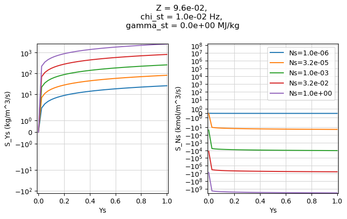

Soot Modeling Example
=====================

*This demo is part of Spitfire, with* `licensing and copyright info
here. <https://github.com/sandialabs/Spitfire/blob/master/license.md>`__

*Highlights*

-  Tabulating and plotting soot source term coefficients
-  Tabulating and plotting soot radiation and absorption coefficients
-  Tabulating and plotting gas radiation and absorption coefficients

In this demo, we build a nonadiabatic flamelet library then add
coefficients relevant to soot modeling and absorption/radiation. The
different model forms are shown in the soot modeling documentation.

The nonadiabatic flamelet library
---------------------------------

First we’ll build a flamelet library for an n-heptane/air system. We are
using the liu-C7 mechanism, which limits the soot modeling to Aksit Moss
since there is no benzene present. The higher fidelity caltech mechanism
incorporates benzene, but takes longer to run.

.. code:: ipython3

    import numpy as np
    import matplotlib.pyplot as plt
    from spitfire import build_nonadiabatic_defect_transient_slfm_library, ChemicalMechanismSpec, compute_soot_source_terms
    from spitfire import tabulate_gas_radiation_model, tabulate_soot_radiation_model, tabulate_soot_source_coefficients
    from spitfire.data.get import datafile

.. code:: ipython3

    mech = ChemicalMechanismSpec(cantera_input=datafile('liu-C7.yaml'), group_name='gas')
    pressure = 101325.
    air = mech.stream(stp_air=True)
    air.TP = 300., pressure
    fuel = mech.stream('TPY', (500., pressure, 'NXC7H16:1'))
    flamelet_specs = {'mech_spec': mech,
                      'oxy_stream': air,
                      'fuel_stream': fuel,
                      'grid_points': 81}
    chivals = np.logspace(-2,0,2)

.. code:: ipython3

    lib = build_nonadiabatic_defect_transient_slfm_library(flamelet_specs, chivals)

.. parsed-literal::

    ----------------------------------------------------------------------------------
    building nonadiabatic (defect) SLFM library
    ----------------------------------------------------------------------------------
    - mechanism: /ascldap/users/earmstr/.conda/envs/spclone2/lib/python3.11/site-packages/spitfire/data/liu-C7.yaml
    - 38 species, 105 reactions
    - stoichiometric mixture fraction: 0.062
    ----------------------------------------------------------------------------------
    ----------------------------------------------------------------------------------
    building adiabatic SLFM library
    ----------------------------------------------------------------------------------
    - mechanism: /ascldap/users/earmstr/.conda/envs/spclone2/lib/python3.11/site-packages/spitfire/data/liu-C7.yaml
    - 38 species, 105 reactions
    - stoichiometric mixture fraction: 0.062
    ----------------------------------------------------------------------------------
       1/   2 (chi_stoich =  1.0e-02 1/s)  converged in   2.57 s, T_max = 2234.0
       2/   2 (chi_stoich =  1.0e+00 1/s)  converged in   2.08 s, T_max = 2097.8
    ----------------------------------------------------------------------------------
    library built in   4.85 s
    ----------------------------------------------------------------------------------
    expanding (transient) enthalpy defect dimension ...
    chi_st =  1.0e-02 1/s converged in   7.30 s
    chi_st =  1.0e+00 1/s converged in   5.87 s
    ----------------------------------------------------------------------------------
    enthalpy defect dimension expanded in  13.18 s
    ----------------------------------------------------------------------------------
    Structuring enthalpy defect dimension ... 
    Initializing ... Done.
    Interpolating onto structured grid ... 
    Progress: 0%--10%--20%--100%
    Structured enthalpy defect dimension built in   1.81 s
    ----------------------------------------------------------------------------------
    library built in  19.85 s
    ----------------------------------------------------------------------------------

Gas Radiation Model
-------------------

First we show how to tabulate gas absorption (``gas_abs_coeff``) and
radiation (``gas_rad_source``) coefficients. The absorption coefficient
has units (1/m) and the radiation coefficient has units (W/m^3).

The default model is ``Barlow_GreyGas``, whose equations are outlined in
the soot modeling documentation. Below we are plotting the coefficients
over mixture fraction and all stoichiometric enthalpy defects for a
single stoichiometric dissipation rate.

.. code:: ipython3

    lib = tabulate_gas_radiation_model(mech, lib, modelname='Barlow_GreyGas')

.. code:: ipython3

    chi_index = 0
    for prop in ['gas_abs_coeff','gas_rad_source']:
        plt.plot(lib.mixture_fraction_values, lib[prop][:,chi_index,:])
        plt.grid(color='lightgray')
        plt.ylabel(prop)
        plt.xlabel('mixture fraction')
        plt.title(f'chi_st = {lib.dissipation_rate_stoich_values[chi_index]:.1e} Hz')
        plt.xlim([-0.01,1.01])
        plt.ylim(bottom=0.)
        plt.show()

.. image:: soot_modeling_files/soot_modeling_6_0.png

.. image:: soot_modeling_files/soot_modeling_6_1.png

Soot Radiation Model
--------------------

Next we show how to tabulate soot absorption (``soot_abs_coeff``) and
radiation (``soot_rad_source``) coefficients. The absorption coefficient
has units (1/m) and the radiation coefficient has units (W/m^3).

The default model is ``linear_absorption_coefficient``, whose equations
are outlined in the soot modeling documentation. This model takes
parameters for the linear slope, intercept, and minimum value. Default
parameter values are zero, which results in no radiation/absorption. We
show suggested values below along with plots of the coefficients over
mixture fraction and all stoichiometric enthalpy defects for a single
stoichiometric dissipation rate.

.. code:: ipython3

    lib = tabulate_soot_radiation_model(mech, lib, modelname='linear_absorption_coefficient', input_modelargs={'slope':1735., 'intercept':-3.75e5})

.. code:: ipython3

    chi_index = 0
    for prop in ['soot_abs_coeff','soot_rad_source']:
        plt.plot(lib.mixture_fraction_values, lib[prop][:,chi_index,:])
        plt.grid(color='lightgray')
        plt.ylabel(prop)
        plt.xlabel('mixture fraction')
        plt.title(f'chi_st = {lib.dissipation_rate_stoich_values[chi_index]:.1e} Hz')
        plt.xlim([-0.01,1.01])
        plt.show()

.. image:: soot_modeling_files/soot_modeling_9_0.png

.. image:: soot_modeling_files/soot_modeling_9_1.png

Soot Source Coefficient Model
-----------------------------

Supported soot models include: ``Aksit_Moss``, ``Aksit_Moss_Benzene``,
and ``PAH_alpha``. The mechanism we used for this demo does not have
benzene, so we will stick with ``Aksit_Moss``. All model equations are
shown in the soot documentation.

Running ``tabulate_soot_source_coefficients`` adds relevant coefficients
for nucleation, coagulation, condensation, surface growth, and surface
oxidation to the library. You can also specify a
``percent_soot_leakage`` which allows soot to leak into fuel-lean
regions of the flame, mimicking a finite-rate oxidation rather than
assuming infinitely fast oxidation which does not allow for soot to be
present near the oxidizer stream. If the percent leakage is less than 1. (and greater than or equal to 0.)
, a ‘soot_subfilter’ property is added showing the function with which
the surface growth and oxidation terms get multiplied with.

Below we show plots of the ‘Aksit_Moss’ coefficients with and without a
1% soot leakage subfilter. The subfilter mainly lowers the oxidation
rates as shown below. Units are as follows: - surface growth and
oxidation (‘surf\_’): kg^(4/3) / m^3 / s / kmol^(1/3) - nucleation
(‘nucl\_’): kmol / m^3 / s - coagulation (‘coag’): kg^(11/6) / m^3 / s /
kmol^(5/6)

.. code:: ipython3

    soot_model = 'Aksit_Moss'
    pct_leakage = 0.01
    lib_p0 = tabulate_soot_source_coefficients(mech, lib, soot_model)
    lib_p1 = tabulate_soot_source_coefficients(mech, lib, soot_model, pct_leakage)

.. code:: ipython3

    logscale = False
    chi_index = 0
    
    colors = ['k','r']
    for prop in ['surf_O2', 'surf_OH', 'surf_C2H2']:
        lp0 = lib_p0[prop][:,chi_index,:]
        lp1 = lib_p1[prop][:,chi_index,:]
    
        plt.plot(lib.mixture_fraction_values, lp0, '-', color=colors[0], linewidth=2)
        plt.plot(lib_p1.mixture_fraction_values, lp1, '-', color=colors[1], linewidth=1)
        #for legend...
        plt.plot(lib.mixture_fraction_values, lp0[:,0], '-', color=colors[0], linewidth=2, label='no subfilter')
        plt.plot(lib_p1.mixture_fraction_values, lp1[:,0], '-', color=colors[1], linewidth=1, label=f'{pct_leakage*100.:.0f}% leakage')
    
        plt.grid(color='lightgray')
        if logscale:
            plt.yscale('log')
        plt.ylim(bottom=1.e-4)
        plt.title(f'chi_st = {lib.dissipation_rate_stoich_values[chi_index]:.1e} Hz')
        plt.xlim([-0.01,1.01])
        plt.ylabel(prop)
        plt.xlabel('mixture fraction')
        plt.legend()
        plt.show()

.. image:: soot_modeling_files/soot_modeling_12_0.png

.. image:: soot_modeling_files/soot_modeling_12_1.png

.. image:: soot_modeling_files/soot_modeling_12_2.png

.. code:: ipython3

    chi_index = 0
    for prop in ['nucl_C2H2','coag','soot_subfilter']:
        plt.plot(lib.mixture_fraction_values, lib_p1[prop][:,chi_index,:])
        plt.grid(color='lightgray')
        plt.ylabel(prop)
        plt.xlabel('mixture fraction')
        plt.title(f'chi_st = {lib.dissipation_rate_stoich_values[chi_index]:.1e} Hz')
        plt.xlim([-0.01,1.01])
        plt.show()

.. image:: soot_modeling_files/soot_modeling_13_0.png

.. image:: soot_modeling_files/soot_modeling_13_1.png

.. image:: soot_modeling_files/soot_modeling_13_2.png

Evaluating Soot Source Terms
----------------------------

Lastly, given a soot number density and mass fraction, the source terms
on a library may be evaluated using ``compute_soot_source_terms``. The
number density is in units (kmol soot / kg air) while the mass fraction
is unitless. If verbose is True, the soot model detected on the library
will be printed.

The ‘clip’ argument (default True), ensures that provided number
densities remain between 1e-16 and 1e6 and mass fractions remain between
1e-16 and 1. The ‘input_mult_dict’ argument can be used to set
multipliers for any of the source term coefficients on a library. For
example, passing {‘c2h2’:2} will double the surface growth coefficient
for acetylene before evaluating the source terms.

Below we plot the source terms for the transport of density-weighted
number density and mass fractions (equations shown in the soot modeling
documentation). We are plotting over the soot mass fraction for varying
values of mixture fraction and soot number density.

.. code:: ipython3

    from spitfire import Library, Dimension
    
    Ns = np.logspace(-6,0,5) # soot number density
    Ys = np.linspace(0,1,41) # soot mass fraction
    
    zst = mech.stoich_mixture_fraction(fuel, air)
    Zs = np.array([zst*0.25, zst, zst*1.5])
    
    # slicing indices for plotting
    chi_index = 0
    gamma_index = 0
    
    for zs in Zs:
        z_index = np.argmax(lib.mixture_fraction_values - zs>=0)
        fig, (ax1, ax2) = plt.subplots(1,2, figsize=(8,4))
    
        for nsi, ns in enumerate(Ns):
            lib_Ys = Library(*lib.dims, Dimension('Ys', Ys))
            for prop in ['S_Ns', 'S_Ys']:
                lib_Ys[prop] = lib_Ys.get_empty_dataset()
    
            for iy, ys in enumerate(Ys):
                src_dict = compute_soot_source_terms(lib_p0, ns, ys, verbose=False)
    
                lib_Ys['S_Ns'][:,:,:,iy] = src_dict['S_Ns'] # soot number density source term
                lib_Ys['S_Ys'][:,:,:,iy] = src_dict['S_Ys'] # soot mass fraction source term
    
            ax1.plot(lib_Ys.Ys_values, lib_Ys['S_Ys'][z_index, chi_index, gamma_index, :].T, label=f'Ns={ns:.1e}')
            ax2.plot(lib_Ys.Ys_values, lib_Ys['S_Ns'][z_index, chi_index, gamma_index, :].T, label=f'Ns={ns:.1e}')
    
        ax1.set_ylabel('S_Ys (kg/m^3/s)')
        ax2.set_ylabel('S_Ns (kmol/m^3/s)')
        plt.suptitle(f'Z = {lib_Ys.mixture_fraction_values[z_index]:.1e}, \nchi_st = {lib_Ys.dissipation_rate_stoich_values[chi_index]:.1e} Hz, \ngamma_st = {lib_Ys.enthalpy_defect_stoich_values[gamma_index]/1.e6:.1e} MJ/kg', y=1.08)
        for ax in [ax1, ax2]:
            ax.set_xlim([-0.01,1.01])
            ax.grid(color='lightgray')
            ax.set_xlabel('Ys')
            ax.set_yscale('symlog')
        plt.legend()
        plt.subplots_adjust(wspace=0.3)
        plt.show()

.. image:: soot_modeling_files/soot_modeling_15_0.png

.. image:: soot_modeling_files/soot_modeling_15_1.png

