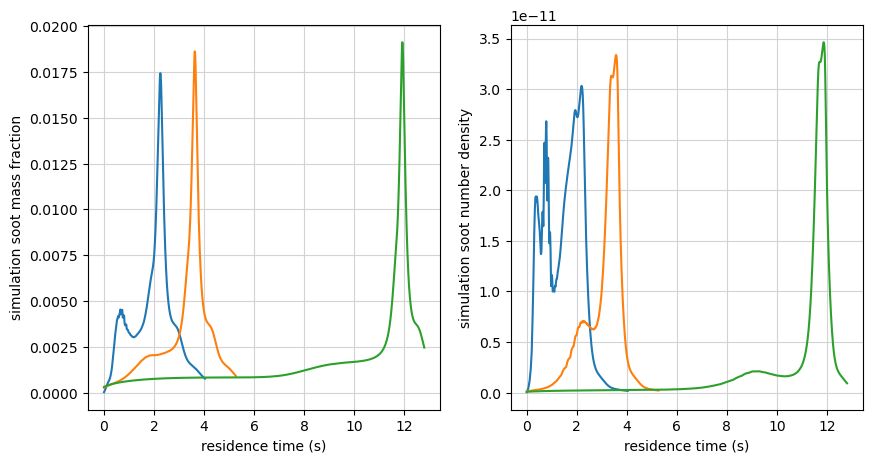
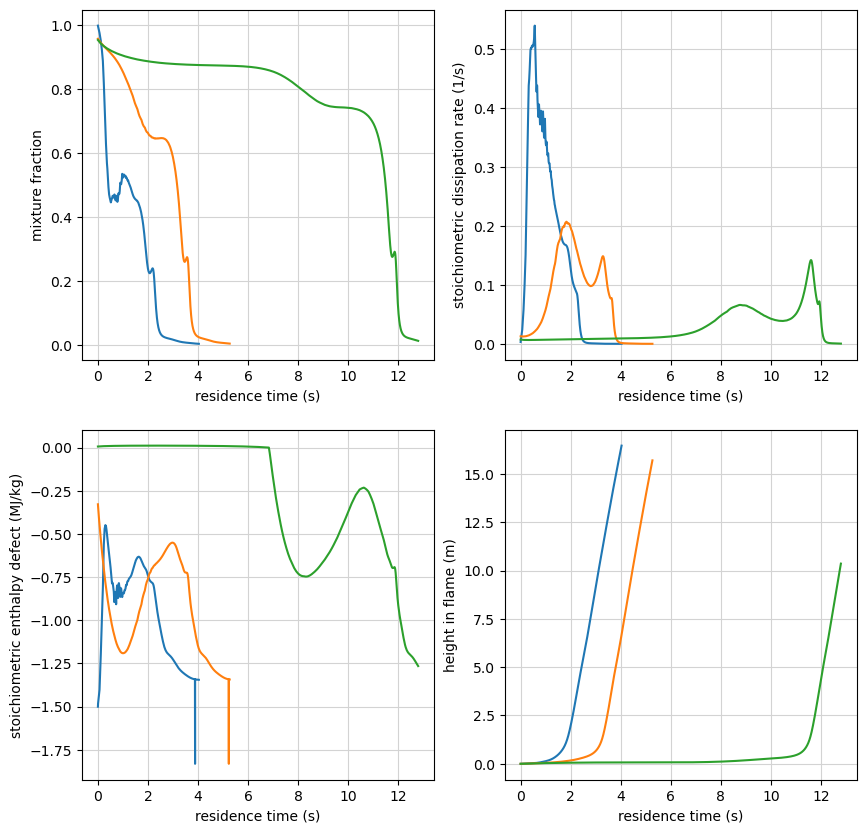
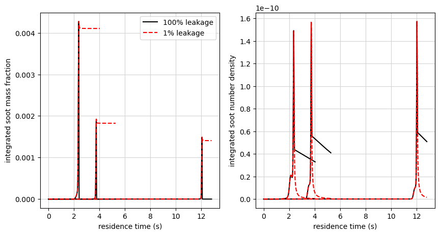

Soot Modeling Example
=====================

*This demo is part of Spitfire, with* `licensing and copyright info
here. <https://github.com/sandialabs/Spitfire/blob/master/license.md>`__

*Highlights*

-  Tabulating and plotting soot source term coefficients
-  Tabulating and plotting soot radiation and absorption coefficients
-  Tabulating and plotting gas radiation and absorption coefficients
-  Integrating soot models along particle trajectories

In this demo, we build a nonadiabatic flamelet library then add
coefficients relevant to soot modeling and absorption/radiation. The
different model forms are shown in the soot modeling documentation. We
then demonstrate how these libraries might be used for simulation with
soot transport.

The nonadiabatic flamelet library
---------------------------------

First we’ll build a flamelet library for an n-heptane/air system. We are
using the liu-C7 mechanism, which limits the soot modeling to Aksit Moss
since there is no benzene present. The higher fidelity caltech mechanism
incorporates benzene, but takes longer to run.

.. code:: ipython3

    import numpy as np
    import matplotlib.pyplot as plt
    import pickle
    from scipy.interpolate import interp1d
    from spitfire import build_nonadiabatic_defect_transient_slfm_library, ChemicalMechanismSpec, odesolve, PIController
    from spitfire import get_soot_source_term_evaluator, tabulate_gas_radiation_model, tabulate_soot_radiation_model, tabulate_soot_source_coefficients
    from spitfire.data.get import datafile
    from spitfire.chemistry.analysis import get_ct_solution_array

.. code:: ipython3

    mech = ChemicalMechanismSpec(cantera_input=datafile('liu-C7.yaml'), group_name='gas')
    pressure = 101325.
    air = mech.stream(stp_air=True)
    air.TP = 300., pressure
    fuel = mech.stream('TPY', (500., pressure, 'NXC7H16:1'))
    flamelet_specs = {'mech_spec': mech,
                      'oxy_stream': air,
                      'fuel_stream': fuel,
                      'grid_points': 81}
    chivals = np.logspace(-2,0,4)

.. code:: ipython3

    lib = build_nonadiabatic_defect_transient_slfm_library(flamelet_specs, chivals)

.. parsed-literal::

    ----------------------------------------------------------------------------------
    building nonadiabatic (defect) SLFM library
    ----------------------------------------------------------------------------------
    - mechanism: /ascldap/users/earmstr/.conda/envs/spclone2/lib/python3.11/site-packages/spitfire/data/liu-C7.yaml
    - 38 species, 105 reactions
    - stoichiometric mixture fraction: 0.062
    ----------------------------------------------------------------------------------
    ----------------------------------------------------------------------------------
    building adiabatic SLFM library
    ----------------------------------------------------------------------------------
    - mechanism: cantera-input-not-given
    - 38 species, 105 reactions
    - stoichiometric mixture fraction: 0.062
    ----------------------------------------------------------------------------------
       1/   4 (chi_stoich =  1.0e-02 1/s)  converged in   3.07 s, T_max = 2234.0
       2/   4 (chi_stoich =  4.6e-02 1/s)  converged in   0.09 s, T_max = 2193.8
       3/   4 (chi_stoich =  2.2e-01 1/s)  converged in   0.05 s, T_max = 2147.3
       4/   4 (chi_stoich =  1.0e+00 1/s)  converged in   0.35 s, T_max = 2097.8
    ----------------------------------------------------------------------------------
    library built in   3.80 s
    ----------------------------------------------------------------------------------
    expanding (transient) enthalpy defect dimension ...
    chi_st =  1.0e-02 1/s converged in   7.47 s
    chi_st =  4.6e-02 1/s converged in   6.90 s
    chi_st =  2.2e-01 1/s converged in   6.42 s
    chi_st =  1.0e+00 1/s converged in   5.86 s
    ----------------------------------------------------------------------------------
    enthalpy defect dimension expanded in  26.66 s
    ----------------------------------------------------------------------------------
    Structuring enthalpy defect dimension ... 
    Initializing ... Done.
    Interpolating onto structured grid ... 
    Progress: 0%--10%--20%--30%--40%--100%
    Structured enthalpy defect dimension built in   3.90 s
    ----------------------------------------------------------------------------------
    library built in  34.43 s
    ----------------------------------------------------------------------------------

Gas Radiation Model
-------------------

Now we tabulate gas absorption (``gas_abs_coeff``) and radiation
(``gas_rad_source``) coefficients. The absorption coefficient has units
(1/m) and the radiation coefficient has units
:math:`(\mathrm{W}/\mathrm{m}^3)`.

The default model is ``Barlow_GreyGas``, whose equations are outlined in
the soot modeling documentation. Below we are plotting the coefficients
over mixture fraction and all stoichiometric enthalpy defects for a
single stoichiometric dissipation rate.

.. code:: ipython3

    lib = tabulate_gas_radiation_model(mech, lib, modelname='Barlow_GreyGas')

.. code:: ipython3

    chi_index = 0
    for prop in ['gas_abs_coeff','gas_rad_source']:
        plt.plot(lib.mixture_fraction_values, lib[prop][:,chi_index,:])
        plt.grid(color='lightgray')
        plt.ylabel(prop)
        plt.xlabel('mixture fraction')
        plt.title(f'chi_st = {lib.dissipation_rate_stoich_values[chi_index]:.1e} Hz')
        plt.xlim([-0.01,1.01])
        plt.ylim(bottom=0.)
        plt.show()

.. image:: soot_modeling_files/soot_modeling_6_0.png

.. image:: soot_modeling_files/soot_modeling_6_1.png

Soot Radiation Model
--------------------

Next we show how to tabulate soot absorption (``soot_abs_coeff``) and
radiation (``soot_rad_source``) coefficients. The absorption coefficient
has units (1/m) and the radiation coefficient has units
:math:`(\mathrm{W}/\mathrm{m}^3)`.

The default model is ``linear_absorption_coefficient``, whose equations
are outlined in the soot modeling documentation. This model takes
parameters for the linear slope, intercept, and minimum value. Default
parameter values are zero, which results in no radiation/absorption. We
show suggested values below along with plots of the coefficients over
mixture fraction and all stoichiometric enthalpy defects for a single
stoichiometric dissipation rate.

.. code:: ipython3

    lib = tabulate_soot_radiation_model(mech, lib, modelname='linear_absorption_coefficient', input_modelargs={'slope':1735., 'intercept':-3.75e5})

.. code:: ipython3

    chi_index = 0
    for prop in ['soot_abs_coeff','soot_rad_source']:
        plt.plot(lib.mixture_fraction_values, lib[prop][:,chi_index,:])
        plt.grid(color='lightgray')
        plt.ylabel(prop)
        plt.xlabel('mixture fraction')
        plt.title(f'chi_st = {lib.dissipation_rate_stoich_values[chi_index]:.1e} Hz')
        plt.xlim([-0.01,1.01])
        plt.show()

.. image:: soot_modeling_files/soot_modeling_9_0.png

.. image:: soot_modeling_files/soot_modeling_9_1.png

Soot Source Coefficient Model
-----------------------------

Supported soot models include: ``Aksit_Moss``, ``Aksit_Moss_Benzene``,
and ``PAH_alpha``. The mechanism we used for this demo does not have
benzene, so we will stick with ``Aksit_Moss``. All model equations are
shown in the soot documentation.

Running ``tabulate_soot_source_coefficients`` adds relevant coefficients
for nucleation, coagulation, condensation, surface growth, and surface
oxidation to the library. You can also specify a
``soot_leakage_fraction`` which controls the amount of soot allowed to
“leak” into fuel-lean regions of the flame, accounting for finite-rate
oxidation. This is based on a sub-filter model for soot oxidation, where
0% leakage corresponds to infinitely fast oxidation (not allowing soot
to be present near the oxidizer stream) and larger leakage rates limit
that oxidation. Using 0.>=\ ``soot_leakage_fraction``>1. adds a
‘soot_subfilter’ property to the library, showing the function with
which the surface growth and oxidation terms get multiplied.

Below we compare the ‘Aksit_Moss’ coefficients with 100% and 1% soot
leakage. Nucleation and coagulation are identical between the two
libraries. The surface growth and oxidation coefficients have been
modified for the smaller leakage, seen more dramatically in the
oxidation coefficients. The 1% leakage limits the amount of soot present
for lean mixtures, assuming it gets oxidized faster than the original
library. Therefore, the oxidation coefficients for the 1% leakage
library are smaller in those lean regions compared to the original 100%
leakage library.

Units are as follows:

-  surface growth and oxidation (‘surf\_’):
   :math:`\mathrm{kg}^{4/3} \mathrm{m}^{-3} \mathrm{s}^{-1} \mathrm{kmol}^{-1/3}`

-  nucleation (‘nucl\_’):
   :math:`\mathrm{kmol}^{1} \mathrm{m}^{-3} \mathrm{s}^{-1}`

-  coagulation (‘coag’):
   :math:`\mathrm{kg}^{11/6} \mathrm{m}^{-3} \mathrm{s}^{-1} \mathrm{kmol}^{-5/6}`

.. code:: ipython3

    soot_model = 'Aksit_Moss'
    lib_p0 = tabulate_soot_source_coefficients(mech, lib, soot_model)
    lib_p1 = tabulate_soot_source_coefficients(mech, lib, soot_model, soot_leakage_fraction=0.01)

.. code:: ipython3

    logscale = False
    chi_index = 0
    
    colors = ['k','r']
    for prop in ['surf_O2', 'surf_OH', 'surf_C2H2']:
        lp0 = lib_p0[prop][:,chi_index,:]
        lp1 = lib_p1[prop][:,chi_index,:]
    
        plt.plot(lib_p0.mixture_fraction_values, lp0, '-', color=colors[0], linewidth=2)
        plt.plot(lib_p1.mixture_fraction_values, lp1, '-', color=colors[1], linewidth=1)
        #for legend...
        plt.plot(lib_p0.mixture_fraction_values, lp0[:,0], '-', color=colors[0], linewidth=2, label='100% leakage')
        plt.plot(lib_p1.mixture_fraction_values, lp1[:,0], '-', color=colors[1], linewidth=1, label=f'1% leakage')
    
        plt.grid(color='lightgray')
        if logscale:
            plt.yscale('log')
        plt.ylim(bottom=1.e-4)
        plt.title(f'chi_st = {lib.dissipation_rate_stoich_values[chi_index]:.1e} Hz')
        plt.xlim([-0.01,1.01])
        plt.ylabel(prop)
        plt.xlabel('mixture fraction')
        plt.legend()
        plt.show()

.. image:: soot_modeling_files/soot_modeling_12_0.png

.. image:: soot_modeling_files/soot_modeling_12_1.png

.. image:: soot_modeling_files/soot_modeling_12_2.png

.. code:: ipython3

    chi_index = 0
    for prop in ['nucl_C2H2','coag','soot_subfilter']:
        plt.plot(lib_p1.mixture_fraction_values, lib_p1[prop][:,chi_index,:])
        plt.grid(color='lightgray')
        plt.ylabel(prop)
        plt.xlabel('mixture fraction')
        plt.title(f'chi_st = {lib_p1.dissipation_rate_stoich_values[chi_index]:.1e} Hz')
        plt.xlim([-0.01,1.01])
        plt.show()

.. image:: soot_modeling_files/soot_modeling_13_0.png

.. image:: soot_modeling_files/soot_modeling_13_1.png

.. image:: soot_modeling_files/soot_modeling_13_2.png

Evaluating Soot Source Terms
----------------------------

Once we have tabulated all relevant soot and radiation coefficients, our
library is ready to use in simulation for a sooting fire that transports
a soot mass fraction (unitless) and soot number density (kmol soot / kg
air). We can compose source terms given the current mass fraction,
number density, and tabulated coefficients following the equations in
our soot documentation. The ``get_soot_source_term_evaluator`` function
will detect which soot model was used to generate a library based on the
species/coefficients present and return the appropriate function for
evaluating the source terms for soot mass fraction and soot number
density. If verbose is True, the soot model detected on the library will
be printed. Below, we find the “aksit-moss” model and save off the
appropriate ``soot_src_aksit_moss`` function.

When evaluated, the source term function will return a dictionary of the
source terms for the soot number density (‘S_Ns’) and soot mass fraction
(‘S_Ys’) along with various contributions to those source terms. The
‘input_mult_dict’ argument can be used to set multipliers for any of the
source term coefficients on a library. For example, passing {‘c2h2’:2}
will double the surface growth coefficient for acetylene before
evaluating the source terms. More details on the supported soot_src\_…
functions can be found in the documentation.

.. code:: ipython3

    src_eval = get_soot_source_term_evaluator(lib_p0)
    src_eval

.. parsed-literal::

    Detected soot model "aksit-moss" in the table.

.. parsed-literal::

    <function spitfire.chemistry.soot.soot_src_aksit_moss(soot_number_density, soot_mass_fraction, nucl_C2H2, coag, surf_C2H2, surf_O2, surf_OH, input_mult_dict=None)>

In order to demonstrate the source term model in action, we load some
particle trajectories over which to transport soot. The
ex_particle_data.pkl file has three particle trajectories from RANS of a
2m-diameter sooting pool fire. The two soot equations were transported
in this simulation, and the result is shown below over each particle’s
residence time. This gives an idea of the soot observed over each
particle trajectory. However, these data were generated with a different
fuel composition and chemical mechanism. We are mainly interested in the
flamelet inputs (mixture fraction, stoichiometric dissipation rate, and
stoichiometric enthalpy defect) observed along these trajectories, which
we also plot, along with the height of the particles, over their
residence times below. These particles also have a scaled scalar
variance, but we will ignore this flamelet dimension to simplify the
demo. It could be added back in if we convolved our libraries over a
mixture fraction presumed PDF using ``apply_mixing_model``. These data
provide realistic particle pathways for us to use in comparing different
soot models a priori.

Using a Lagrangian reference for each of the particles as they travel
along their trajectories, we can define the following ODEs for soot
production due to reaction alone

:math:`\frac{\mathrm{d}N_s}{\mathrm{d}t} = \dot{S_{N_s}}/\rho`

:math:`\frac{\mathrm{d}Y_s}{\mathrm{d}t} = \dot{S_{Y_s}}/\rho`

and integrate them along those trajectories in order to estimate soot
levels from different libraries. We will be comparing soot levels from
using the 100% and 1% soot leakage models with Aksit-Moss, where we
expect the 1% soot leakage to produce more soot since oxidation is more
limited. We would expect higher soot levels when including the effects
of benzene, but that would require using a different mechanism as
mentioned at the start of the demo.

This analysis ignores the effects of diffusion with and without
turbulence, which become more important near edges of the flame.
Therefore, we can’t expect accurate estimates from reaction alone in
those regions, especially as the particles travel higher in the flames.
We will focus on maximum and average soot values around heights of 2.5
times the pool diameter of 2 meters.

.. code:: ipython3

    ### loading particle data
    with open(f'ex_particle_data.pkl', 'rb') as handle:
        particle_data = pickle.load(handle)
    
    fig, ax = plt.subplots(1,2, figsize=(10,5))
    for it in particle_data:
        ax[0].plot(particle_data[it]['residence_time'], particle_data[it]['sim_Ys'])
        ax[1].plot(particle_data[it]['residence_time'], particle_data[it]['sim_Ns'])
    ax[0].set_ylabel('simulation soot mass fraction')
    ax[1].set_ylabel('simulation soot number density')
    for a in ax:
        a.set_xlabel('residence time (s)')
        a.grid(color='lightgray')
    plt.show()
    
    fig, ax = plt.subplots(2,2, figsize=(10,10))
    for it in particle_data:
        ax[0,0].plot(particle_data[it]['residence_time'], particle_data[it]['z'])
        ax[0,1].plot(particle_data[it]['residence_time'], particle_data[it]['xst'])
        ax[1,0].plot(particle_data[it]['residence_time'], particle_data[it]['gst']/1.e6)
        ax[1,1].plot(particle_data[it]['residence_time'], particle_data[it]['height'])
    ax[0,0].set_ylabel('mixture fraction')
    ax[0,1].set_ylabel('stoichiometric dissipation rate (1/s)')
    ax[1,0].set_ylabel('stoichiometric enthalpy defect (MJ/kg)')
    ax[1,1].set_ylabel('height in flame (m)')
    for a in ax.ravel():
        a.set_xlabel('residence time (s)')
        a.grid(color='lightgray')
    plt.show()

We first add density onto each of the libraries, which is needed in the
soot ODEs.

.. code:: ipython3

    ctsol0, lib_shape0 = get_ct_solution_array(mech, lib_p0)
    lib_p0['density'] = ctsol0.density_mass.reshape(lib_shape0)
    
    ctsol1, lib_shape1 = get_ct_solution_array(mech, lib_p1)
    lib_p1['density'] = ctsol1.density_mass.reshape(lib_shape1)

Then we interpolate all of the library properties over the flamelet
inputs. This allows us to evaluate the libraries at arbitrary flamelet
parameters during integration. The cell below requires the
``pytabprops`` library to be installed.

.. code:: ipython3

    from pytabprops import LagrangeInterpolant3D, StateTable
    
    def table_interp(lib_to_tab):
        tbl = StateTable()
        for prop in lib_to_tab.props:
            interp = LagrangeInterpolant3D(3,
                                        lib_to_tab.mixture_fraction_values,
                                        lib_to_tab.dissipation_rate_stoich_values,
                                        np.abs(lib_to_tab.enthalpy_defect_stoich_values),
                                        lib_to_tab[prop].ravel(order='F'), 
                                        True)
            tbl.add_entry(prop, interp, ['z','chi','gamma'])
            # checking the reconstruction...
            pred = tbl.query(prop,
                    lib_to_tab.mixture_fraction_grid,
                    lib_to_tab.dissipation_rate_stoich_grid,
                    np.abs(lib_to_tab.enthalpy_defect_stoich_grid))
            err = np.max(np.abs(pred - lib_to_tab[prop]))
            if err>1.e-16:
                print(f'failed reconstruction for {prop} with error {err:.2e}')
        return tbl
    
    tbl_p0 = table_interp(lib_p0)
    tbl_p1 = table_interp(lib_p1)

Now we can use Spitfire’s ``odesolve`` to integrate the two ODEs. This
expects a source term function to take in time and the current state,
which we define below as ``ode_src``. This function evaluates the
flamelet parameters given the current time, then uses those to query our
interpolated coefficients and density. We can then return the source
terms evaluated with our saved function ``src_eval``. We initialize the
state to very small soot levels, but this can also be played with
depending on the initial placement in the flame.

.. code:: ipython3

    def particle_interpolants(particle_idx):
        residence_time = particle_data[particle_idx]['residence_time']
        z   = particle_data[particle_idx]['z']
        xst = particle_data[particle_idx]['xst']
        gst = particle_data[particle_idx]['gst']
    
        z_interp   = interp1d(residence_time, z,           kind='linear')
        xst_interp = interp1d(residence_time, xst,         kind='linear')
        gst_interp = interp1d(residence_time, np.abs(gst), kind='linear')
        return z_interp, xst_interp, gst_interp
    
    def particle_integrals(tbl):
        integral_dict = {}
        for ip in particle_data:
            integral_dict[ip] = {}
            residence_time = particle_data[ip]['residence_time']
            z_interp, xst_interp, gst_interp = particle_interpolants(ip)
    
            def ode_src(t, NsYs):
                z = z_interp(t)
                x_st = xst_interp(t)
                g_st = gst_interp(t)
                inputs = [z, x_st, g_st]
    
                rho = tbl.query('density', *inputs)
                nucl_C2H2 = tbl.query('nucl_C2H2', *inputs)
                coag = tbl.query('coag', *inputs)
                surf_C2H2 = tbl.query('surf_C2H2', *inputs)
                surf_O2 = tbl.query('surf_O2', *inputs)
                surf_OH = tbl.query('surf_OH', *inputs)
    
                soot_number_density = np.min([np.max([NsYs[0], 1.e-16]), 1.e6])
                soot_mass_fraction  = np.min([np.max([NsYs[1], 1.e-16]), 1.])
                
                srcs = src_eval(soot_number_density, soot_mass_fraction, nucl_C2H2, coag, surf_C2H2, surf_O2, surf_OH)
                return np.array([srcs['S_Ns'], srcs['S_Ys']])/rho
    
            init = 1.e-16*np.ones(2,)
            ts, NsYs = odesolve(ode_src, init, save_each_step=True, stop_at_time=residence_time.max(),
                                step_size=PIController(target_error=1.e-10, first_step=1.e-3, max_step=2.5e-2))
            integral_dict[ip]['t'] = ts
            integral_dict[ip]['Ns'] = NsYs[:,0]
            integral_dict[ip]['Ys'] = NsYs[:,1]
        return integral_dict
    
    integrals_p0 = particle_integrals(tbl_p0)
    integrals_p1 = particle_integrals(tbl_p1)

Below we plot the results for soot mass fraction and number density for
each of the soot models. The peak soot values for both models are
actually very similar, with the 1% leakage being slightly larger. The
main difference is the behavior after hitting peak production, where the
larger oxidation from 100% leakage pulls soot down to essentially zero
while 1% leakage maintains a larger level. However, after the peak
production, the particles start to rise higher in the flame, where we
would expect diffusion to pull down those soot levels even more (similar
to the trends seen above in the simulation soot profiles).

.. code:: ipython3

    fig, ax = plt.subplots(1,2, figsize=(10,5))
    for it in integrals_p0:
        ax[0].plot(integrals_p0[it]['t'], integrals_p0[it]['Ys'], 'k-', label='100% leakage' if it==0 else None)
        ax[1].plot(integrals_p0[it]['t'], integrals_p0[it]['Ns'], 'k-')
        ax[0].plot(integrals_p1[it]['t'], integrals_p1[it]['Ys'], 'r--', label='1% leakage' if it==0 else None)
        ax[1].plot(integrals_p1[it]['t'], integrals_p1[it]['Ns'], 'r--')
    ax[0].set_ylabel('integrated soot mass fraction')
    ax[1].set_ylabel('integrated soot number density')
    ax[0].legend()
    for a in ax:
        a.set_xlabel('residence time (s)')
        a.grid(color='lightgray')
    plt.show()

The soot volume fraction is another useful quantity to analyze. This can
be calculated from

:math:`f_v = Y_s \rho / \rho_s`

where the density of soot
:math:`\rho_s = 1800 \ \mathrm{kg}/\mathrm{m}^3`. The 1% leakage model
reaches higher levels as expected.

.. code:: ipython3

    for it in integrals_p0:
        z_interp, xst_interp, gst_interp = particle_interpolants(it)
    
        ts_p0 = integrals_p0[it]['t']
        z_p0 = z_interp(ts_p0)
        x_st_p0 = xst_interp(ts_p0)
        g_st_p0 = gst_interp(ts_p0)
        inputs_p0 = [z_p0, x_st_p0, g_st_p0]
    
        ts_p1 = integrals_p1[it]['t']
        z_p1 = z_interp(ts_p1)
        x_st_p1 = xst_interp(ts_p1)
        g_st_p1 = gst_interp(ts_p1)
        inputs_p1 = [z_p1, x_st_p1, g_st_p1]
    
        rho_p0 = tbl_p0.query('density', *inputs_p0)
        rho_p1 = tbl_p1.query('density', *inputs_p1)
        fv_ppm_p0 = integrals_p0[it]['Ys'] * rho_p0 / 1800. * 1.e6
        fv_ppm_p1 = integrals_p1[it]['Ys'] * rho_p1 / 1800. * 1.e6
    
        plt.plot(ts_p0, fv_ppm_p0,'k-', label='100% leakage' if it==0 else None)
        plt.plot(ts_p1, fv_ppm_p1,'r--', label='1% leakage' if it==0 else None)
    plt.xlabel('residence time (s)')
    plt.ylabel('soot volume fraction (ppm)')
    plt.legend()
    plt.grid(color='lightgray')
    plt.show()

.. image:: soot_modeling_files/soot_modeling_27_0.png

Finally we plot the average soot mass fraction of each model for
different heights in the flame over mixture fraction. Heights are
documented as factors of the pool diameter D = 2m. Below 2.25D, soot
levels are low and there is little difference between the models. The
largest difference happens between 2.25D and 2.5D where the 1% leakage
model produces almost twice as much soot on average than the 100%
leakage model, especially at smaller mixture fraction where oxidation is
taking place. As we continue higher in the flame, the soot levels for
the 1% leakage model flatten out, which is where we expect diffusion to
become more important and reduce those levels in reality.

.. code:: ipython3

    D = 2. # 2m diameter
    
    zbins = np.linspace(0.,0.5,21)
    Dbins = np.linspace(1.75,3.25,7)
    
    zspace = zbins[1] - zbins[0]
    zcenters = zbins[:-1] + 0.5*zspace
    
    fig, axs = plt.subplots(2,3, figsize=(10,7), sharey=True)
    for id in range(Dbins.size-1):
        Ysums_p0 = np.zeros(zbins.size-1)
        Ycount_p0 = np.zeros(zbins.size-1)
        Ysums_p1 = np.zeros(zbins.size-1)
        Ycount_p1 = np.zeros(zbins.size-1)
        for ip in integrals_p0:
            h = particle_data[ip]['height']
            Z = particle_data[ip]['z']
            t = particle_data[ip]['residence_time']
            Z_interp = interp1d(t, Z, kind='linear')
            h_interp = interp1d(t, h, kind='linear')
    
            t_p0 = integrals_p0[ip]['t']
            Z_p0 = Z_interp(t_p0)
            h_p0 = h_interp(t_p0)
            Ys_p0 = integrals_p0[ip]['Ys']
            hidx_p0 = np.argwhere((Dbins[id]*D<=h_p0)&(h_p0<Dbins[id+1]*D))
            Z_p0 = Z_p0[hidx_p0]
            Ys_p0 = Ys_p0[hidx_p0]
    
            t_p1 = integrals_p1[ip]['t']
            Z_p1 = Z_interp(t_p1)
            h_p1 = h_interp(t_p1)
            Ys_p1 = integrals_p1[ip]['Ys']
            hidx_p1 = np.argwhere((Dbins[id]*D<=h_p1)&(h_p1<Dbins[id+1]*D))
            Z_p1 = Z_p1[hidx_p1]
            Ys_p1 = Ys_p1[hidx_p1]
    
            for iz in range(zbins.size-1):
                zidx_p0 = np.argwhere((Z_p0>=zbins[iz])&(Z_p0<zbins[iz+1]))
                Ysums_p0[iz] += np.sum(Ys_p0[zidx_p0])
                Ycount_p0[iz] += Ys_p0[zidx_p0].size
    
                zidx_p1 = np.argwhere((Z_p1>=zbins[iz])&(Z_p1<zbins[iz+1]))
                Ysums_p1[iz] += np.sum(Ys_p1[zidx_p1])
                Ycount_p1[iz] += Ys_p1[zidx_p1].size
    
        Yavg_p0 = Ysums_p0/(Ycount_p0+1.e-16)
        Yavg_p1 = Ysums_p1/(Ycount_p1+1.e-16)
    
        axs.ravel()[id].bar(zcenters-zspace/4., Yavg_p0, width=zspace*0.49,color='k',zorder=10, label='100% leakage')
        axs.ravel()[id].bar(zcenters+zspace/4., Yavg_p1, width=zspace*0.49,color='r',zorder=10, label='1% leakage')
        axs.ravel()[id].grid(True, color='lightgray')
        axs.ravel()[id].set_xlim([zbins.min(), zbins.max()])
        axs.ravel()[id].set_title(f'{Dbins[id]}D<=h<{Dbins[id+1]}D')
        axs.ravel()[id].set_ylim([0.,0.005])
    for id in [0,3]:
        axs.ravel()[id].set_ylabel("average soot mass fraction")
    for id in [3,4,5]:
        axs.ravel()[id].set_xlabel('mixture fraction bins')
    axs.ravel()[0].legend()
    plt.show()

.. image:: soot_modeling_files/soot_modeling_29_0.png

