Soot Modeling Example
=====================

*This demo is part of Spitfire, with* `licensing and copyright info
here. <https://github.com/sandialabs/Spitfire/blob/master/license.md>`__

*Highlights*

-  Tabulating and plotting soot source term coefficients
-  Tabulating and plotting soot radiation and absorption coefficients
-  Tabulating and plotting gas radiation and absorption coefficients
-  Comparing soot models along particle trajectories

In this demo, we build a nonadiabatic flamelet library then add
coefficients relevant to soot modeling and absorption/radiation. The
different model forms are shown in the soot modeling documentation. We
then demonstrate how these libraries might be analyzed for use in
simulation with soot transport.

The nonadiabatic flamelet library
---------------------------------

First we’ll build a flamelet library for an n-heptane/air system. We are
using the liu-C7 mechanism, which limits the soot modeling to Aksit Moss
since there is no benzene present. The higher fidelity caltech mechanism
incorporates benzene, but takes longer to run.

.. code:: ipython3

    import numpy as np
    import matplotlib.pyplot as plt
    from scipy.interpolate import interp1d
    from spitfire import build_nonadiabatic_defect_transient_slfm_library, ChemicalMechanismSpec, odesolve, PIController
    from spitfire import get_soot_source_term_evaluator, get_soot_source_term_jacobian_evaluator, tabulate_gas_radiation_model, tabulate_soot_radiation_model, tabulate_soot_source_coefficients
    from spitfire.data.get import datafile

.. code:: ipython3

    mech = ChemicalMechanismSpec(cantera_input=datafile('liu-C7.yaml'), group_name='gas')
    pressure = 101325.
    air = mech.stream(stp_air=True)
    air.TP = 300., pressure
    fuel = mech.stream('TPY', (500., pressure, 'NXC7H16:1'))
    flamelet_specs = {'mech_spec': mech,
                      'oxy_stream': air,
                      'fuel_stream': fuel,
                      'grid_points': 81}
    chivals = np.logspace(-2,0,4)

.. code:: ipython3

    lib = build_nonadiabatic_defect_transient_slfm_library(flamelet_specs, chivals)

.. parsed-literal::

    ----------------------------------------------------------------------------------
    building nonadiabatic (defect) SLFM library
    ----------------------------------------------------------------------------------
    - mechanism: /ascldap/users/earmstr/.conda/envs/spclone2/lib/python3.11/site-packages/spitfire/data/liu-C7.yaml
    - 38 species, 105 reactions
    - stoichiometric mixture fraction: 0.062
    ----------------------------------------------------------------------------------
    ----------------------------------------------------------------------------------
    building adiabatic SLFM library
    ----------------------------------------------------------------------------------
    - mechanism: cantera-input-not-given
    - 38 species, 105 reactions
    - stoichiometric mixture fraction: 0.062
    ----------------------------------------------------------------------------------
       1/   4 (chi_stoich =  1.0e-02 1/s)  converged in   2.57 s, T_max = 2234.0
       2/   4 (chi_stoich =  4.6e-02 1/s)  converged in   0.08 s, T_max = 2193.8
       3/   4 (chi_stoich =  2.2e-01 1/s)  converged in   0.05 s, T_max = 2147.3
       4/   4 (chi_stoich =  1.0e+00 1/s)  converged in   0.32 s, T_max = 2097.8
    ----------------------------------------------------------------------------------
    library built in   3.27 s
    ----------------------------------------------------------------------------------
    expanding (transient) enthalpy defect dimension ...
    chi_st =  1.0e-02 1/s converged in   7.10 s
    chi_st =  4.6e-02 1/s converged in   7.87 s
    chi_st =  2.2e-01 1/s converged in   6.35 s
    chi_st =  1.0e+00 1/s converged in   5.42 s
    ----------------------------------------------------------------------------------
    enthalpy defect dimension expanded in  26.75 s
    ----------------------------------------------------------------------------------
    Structuring enthalpy defect dimension ... 
    Initializing ... Done.
    Interpolating onto structured grid ... 
    Progress: 0%--10%--20%--30%--40%--100%
    Structured enthalpy defect dimension built in   3.82 s
    ----------------------------------------------------------------------------------
    library built in  33.90 s
    ----------------------------------------------------------------------------------

Gas Radiation Model
-------------------

Now we tabulate gas absorption (``gas_abs_coeff``) and radiation
(``gas_rad_source``) coefficients. The absorption coefficient has units
(1/m) and the radiation coefficient has units
:math:`(\mathrm{W}/\mathrm{m}^3)`.

The default model is ``Barlow_GreyGas``, whose equations are outlined in
the soot modeling documentation. Below we are plotting the coefficients
over mixture fraction and all stoichiometric enthalpy defects for a
single stoichiometric dissipation rate.

.. code:: ipython3

    lib = tabulate_gas_radiation_model(mech, lib, modelname='Barlow_GreyGas')

.. code:: ipython3

    chi_index = 0
    for prop in ['gas_abs_coeff','gas_rad_source']:
        plt.plot(lib.mixture_fraction_values, lib[prop][:,chi_index,:])
        plt.grid(color='lightgray')
        plt.ylabel(prop)
        plt.xlabel('mixture fraction')
        plt.title(f'chi_st = {lib.dissipation_rate_stoich_values[chi_index]:.1e} Hz')
        plt.xlim([-0.01,1.01])
        plt.ylim(bottom=0.)
        plt.show()

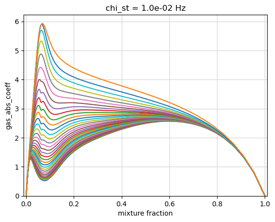

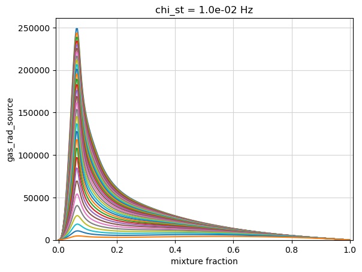

Soot Radiation Model
--------------------

Next we show how to tabulate soot absorption (``soot_abs_coeff``) and
radiation (``soot_rad_source``) coefficients. The absorption coefficient
has units (1/m) and the radiation coefficient has units
:math:`(\mathrm{W}/\mathrm{m}^3)`.

The default model is ``linear_absorption_coefficient``, whose equations
are outlined in the soot modeling documentation. This model takes
parameters for the linear slope, intercept, and minimum value, for which
we are using default values. Below we plot the coefficients over mixture
fraction and all stoichiometric enthalpy defects for a single
stoichiometric dissipation rate.

.. code:: ipython3

    lib = tabulate_soot_radiation_model(mech, lib, modelname='linear_absorption_coefficient')

.. code:: ipython3

    chi_index = 0
    for prop in ['soot_abs_coeff','soot_rad_source']:
        plt.plot(lib.mixture_fraction_values, lib[prop][:,chi_index,:])
        plt.grid(color='lightgray')
        plt.ylabel(prop)
        plt.xlabel('mixture fraction')
        plt.title(f'chi_st = {lib.dissipation_rate_stoich_values[chi_index]:.1e} Hz')
        plt.xlim([-0.01,1.01])
        plt.show()

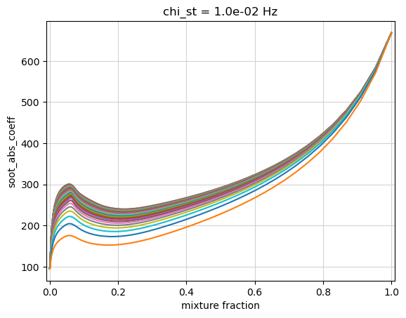

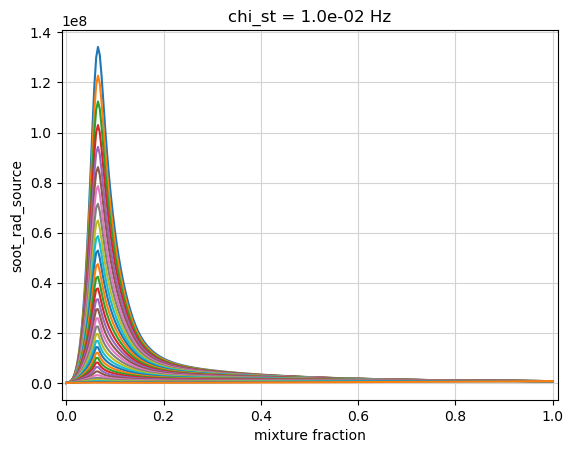

Soot Source Coefficient Model
-----------------------------

Supported soot models include: ``Aksit_Moss``, ``Aksit_Moss_Benzene``,
and ``PAH_alpha``. The mechanism we used for this demo does not have
benzene, so we will stick with ``Aksit_Moss``. All model equations are
shown in the soot documentation.

Running ``tabulate_soot_source_coefficients`` adds relevant coefficients
for nucleation, coagulation, condensation, surface growth, and surface
oxidation to the library. You can also specify a
``soot_leakage_fraction`` which controls the amount of soot allowed to
“leak” into fuel-lean regions of the flame, accounting for finite-rate
oxidation. This is based on a sub-filter model for soot oxidation, where
0% leakage corresponds to infinitely fast oxidation (not allowing soot
to be present near the oxidizer stream) and larger leakage rates limit
that oxidation. Using 0.>=\ ``soot_leakage_fraction``>1. adds a
‘soot_subfilter’ property to the library, showing the function with
which the surface growth and oxidation terms get multiplied.

Below we compare the ‘Aksit_Moss’ coefficients with 100% and 1% soot
leakage. Nucleation and coagulation are identical between the two
libraries. The surface growth and oxidation coefficients have been
modified for the smaller leakage, seen more dramatically in the
oxidation coefficients. The 1% leakage limits the amount of soot present
for lean mixtures, assuming it gets oxidized faster than the original
library. Therefore, the oxidation coefficients for the 1% leakage
library are smaller in those lean regions compared to the original 100%
leakage library.

Units are as follows:

-  surface growth and oxidation (‘surf\_’):
   :math:`\mathrm{kg}^{4/3} \mathrm{m}^{-3} \mathrm{s}^{-1} \mathrm{kmol}^{-1/3}`

-  nucleation (‘nucl\_’):
   :math:`\mathrm{kmol}^{1} \mathrm{m}^{-3} \mathrm{s}^{-1}`

-  coagulation (‘coag’):
   :math:`\mathrm{kg}^{11/6} \mathrm{m}^{-3} \mathrm{s}^{-1} \mathrm{kmol}^{-5/6}`

.. code:: ipython3

    soot_model = 'Aksit_Moss'
    lib_p0 = tabulate_soot_source_coefficients(mech, lib, soot_model)
    lib_p1 = tabulate_soot_source_coefficients(mech, lib, soot_model, soot_leakage_fraction=0.01)

.. code:: ipython3

    logscale = False
    chi_index = 0
    
    colors = ['k','r']
    for prop in ['surf_O2', 'surf_OH', 'surf_C2H2']:
        lp0 = lib_p0[prop][:,chi_index,:]
        lp1 = lib_p1[prop][:,chi_index,:]
    
        plt.plot(lib_p0.mixture_fraction_values, lp0, '-', color=colors[0], linewidth=2)
        plt.plot(lib_p1.mixture_fraction_values, lp1, '-', color=colors[1], linewidth=1)
        #for legend...
        plt.plot(lib_p0.mixture_fraction_values, lp0[:,0], '-', color=colors[0], linewidth=2, label='100% leakage')
        plt.plot(lib_p1.mixture_fraction_values, lp1[:,0], '-', color=colors[1], linewidth=1, label=f'1% leakage')
    
        plt.grid(color='lightgray')
        if logscale:
            plt.yscale('log')
        plt.ylim(bottom=1.e-4)
        plt.title(f'chi_st = {lib.dissipation_rate_stoich_values[chi_index]:.1e} Hz')
        plt.xlim([-0.01,1.01])
        plt.ylabel(prop)
        plt.xlabel('mixture fraction')
        plt.legend()
        plt.show()

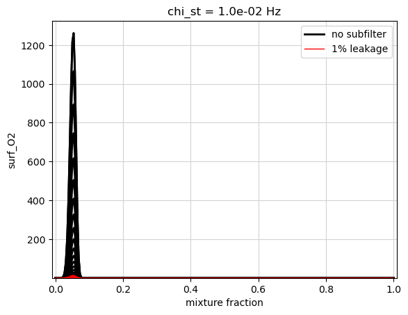

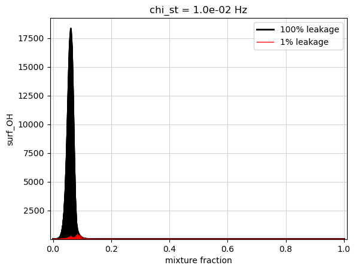

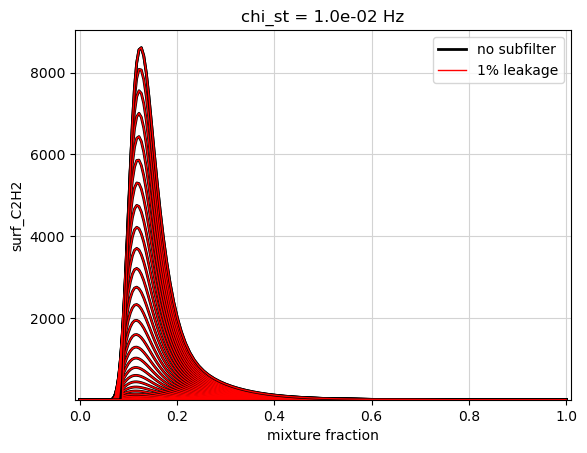

.. code:: ipython3

    chi_index = 0
    for prop in ['nucl_C2H2','coag','soot_subfilter']:
        plt.plot(lib_p1.mixture_fraction_values, lib_p1[prop][:,chi_index,:])
        plt.grid(color='lightgray')
        plt.ylabel(prop)
        plt.xlabel('mixture fraction')
        plt.title(f'chi_st = {lib_p1.dissipation_rate_stoich_values[chi_index]:.1e} Hz')
        plt.xlim([-0.01,1.01])
        plt.show()

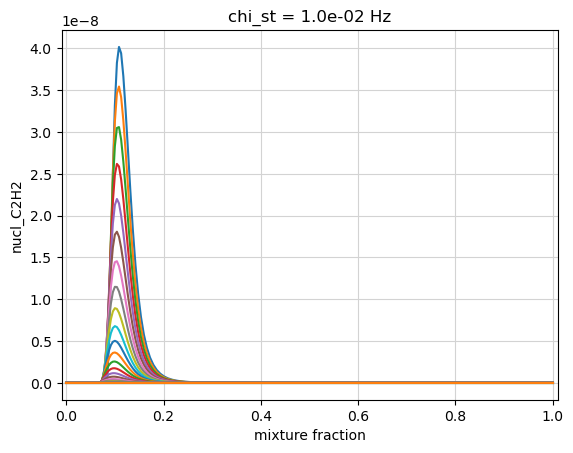

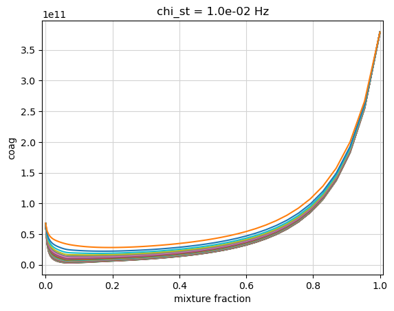

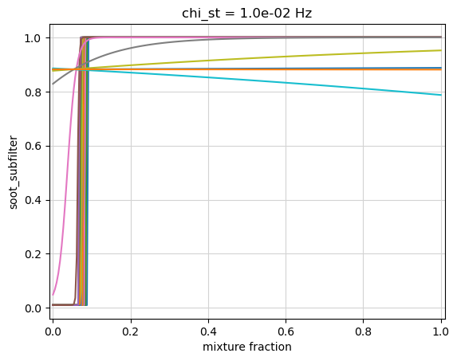

Comparing Soot Models for Transport
-----------------------------------

Once we have tabulated all relevant soot and radiation coefficients, our
library is ready to use in simulation for a sooting fire that transports
a soot mass fraction (unitless) and soot number density (kmol soot / kg
air).

If we have simulation data available from transporting soot, we can use
it to perform a sensitivity analysis on the soot levels with respect to
the flamelet model. For example, we can estimate the change in soot
levels for different leakage fractions or various multipliers on the
terms composing the soot source terms. We first write the soot equations
for :math:`\bar{\phi}=(N_s, Y_s)` in terms of the kinetics
:math:`K = \dot{S}/\rho` and all other effects :math:`T`, such as
diffusion:

:math:`D_t\bar{\phi} = K(\bar{\phi}) + T(\bar{\phi})`

Assuming we have a solution :math:`\bar{\phi}_o` along a certain
streamline or particle trajectory, we now want to estimate the change in
:math:`\bar{\phi}` for a new :math:`K` model, assuming a similar
streamline. We perform a Taylor series expansion for :math:`K` centered
about the known state :math:`\bar{\phi}_o` to get

:math:`D_t\bar{\phi} = K(\bar{\phi}_o) + J(\bar{\phi}_o)(\bar{\phi} - \bar{\phi}_o) + T(\bar{\phi})`

with soot source Jacobian :math:`J` respresenting sensitivities of
:math:`K` to :math:`\bar{\phi}`. We will also assume
:math:`T(\bar{\phi}) = T(\bar{\phi}_o)` or, in other words, that the
soot particle trajectory does not change with a new kinetics model. This
assumption should be fine for solutions :math:`\bar{\phi}` close enough
to :math:`\bar{\phi}_o`, and allows us to isolate changes due to the
flamelet model alone. From rearranging the original solution,
:math:`T(\bar{\phi}_o) = D_t\bar{\phi}_o - K_o(\bar{\phi}_o)`, where
:math:`K_o(\bar{\phi}_o)` is the original model evaluated at the
original solution, we get a transport equation using the new model

:math:`D_t\bar{\phi} = K(\bar{\phi}_o) + J(\bar{\phi}_o)(\bar{\phi} - \bar{\phi}_o) + D_t\bar{\phi}_o - K_o(\bar{\phi}_o)`

which could also be written as

:math:`D_t\bar{\phi} - D_t\bar{\phi}_o = K(\bar{\phi}_o) - K_o(\bar{\phi}_o) + J(\bar{\phi}_o)(\bar{\phi} - \bar{\phi}_o)`.

In reading the equation above, we reiterate that
:math:`K_o(\bar{\phi}_o)` represents the original model used in
simulation evaluated at the original solution from simulation while
:math:`K(\bar{\phi}_o)` and :math:`J(\bar{\phi}_o)` would be using the
new flamelet model evaluated at the original solution. This gives us a
decent estimate for new soot levels :math:`\bar{\phi}` when using
various flamelet models, as long as they remain close enough to the
original solution :math:`\bar{\phi}_o`.

We demonstrate this analysis below for a made up solution
:math:`\bar{\phi}_o`, providing functions of time for the flamelet
variables and the soot quantities. These are plotted below over the
residence time of the soot particle. We also provide the original
kinetics model as a function of time and use the derivative of an
interpolant for :math:`\bar{\phi}_o` over time in order to estimate the
original time derivative :math:`D_t\bar{\phi}_o`. This demo requires the
``pytabprops`` library to be installed.

.. code:: ipython3

    from pytabprops import StateTable, LagrangeInterpolant1D, LagrangeInterpolant4D
    from spitfire import apply_mixing_model, PDFSpec
    
    ##### 'original' simulation solution quantities:
    
    def z_sim(t): # mixture fraction
        return -(0.4*np.exp(-0.0004*(t-5)**4) + 0.5*np.exp(-0.1*(t-14.5)**2) + 0.9*np.exp(-0.08*(t-17.)**4) - 1.25)
    
    def xst_sim(t): # stoichiometric dissipation rate
        return 0.05*np.exp(-0.4*(t-13.8)**2)+ 0.11*np.exp(-8.*(t-15.2)**2) + 0.01
    
    def gst_sim(t): # stoichiometric enthalpy defect
        return -1.e6*(0.62*np.exp(-0.8*(t-13.)**4) + 1.3*np.exp(-0.3*(t-16.5)**2))
    
    def sv_sim(t): # scaled scalar variance
        return 0.05*np.exp(-0.4*(t-13.5)**2)+ 0.13*np.exp(-8.*(t-15.3)**2) + 0.09
    
    def ys_sim(t): # soot mass fraction
        return 0.0008*np.exp(-0.0008*(t-5)**4) + 0.002*np.exp(-0.1*(t-14.5)**2) + 0.018*np.exp(-8.*(t-15.5)**2) 
    
    def ns_sim(t): # soot number density
        return 1.e-11*(0.3*np.exp(-0.4*(t-14.5)**2) + 3.3*np.exp(-8.*(t-15.4)**2) + 0.03) 
    
    def kys_sim(t): # soot mass fraction kinetics model (source term over density)
        return 0.072*np.exp(-18.*(t-15.5)**2)
    
    def kns_sim(t): # soot number density kinetics model (source term over density)
        return 1.e-11*(1*np.exp(-5.e-8*(t-5.)**8) + 7.5*np.exp(-18.*(t-15.25)**2) + 0.2*np.exp(-1.*(t-12.5)**2) + 0.15*np.exp(-10.*(t-14.5)**2) + 1.*np.exp(-1.*(t-17)**4) - 1.)
    
    t_sim = np.linspace(0., 16., 1000) # residence times
    
    Ys_sim = ys_sim(t_sim)
    Ns_sim = ns_sim(t_sim)
    
    tbl_orig_rhs = StateTable()
    tbl_orig_rhs.add_entry('Ys', LagrangeInterpolant1D(1, t_sim, Ys_sim, True), ['t'])
    tbl_orig_rhs.add_entry('Ns', LagrangeInterpolant1D(1, t_sim, Ns_sim, True), ['t'])
    def rys_sim(t): # soot mass fraction time derivative
        return tbl_orig_rhs.derivative('Ys', t)
    def rns_sim(t): # soot number density time derivative
        return tbl_orig_rhs.derivative('Ns', t)
    
    
    fig, ax = plt.subplots(1,2, figsize=(10,5))
    ax[0].plot(t_sim, Ys_sim)
    ax[1].plot(t_sim, Ns_sim)
    ax[0].set_ylabel('simulation soot mass fraction')
    ax[1].set_ylabel('simulation soot number density')
    for a in ax:
        a.set_xlabel('residence time (s)')
        a.grid(color='lightgray')
    plt.suptitle("'original' simulation solution")
    plt.show()
    
    fig, ax = plt.subplots(2,2, figsize=(10,10))
    ax[0,0].plot(t_sim, z_sim(t_sim))
    ax[0,1].plot(t_sim, xst_sim(t_sim))
    ax[1,0].plot(t_sim, gst_sim(t_sim)/1.e6)
    ax[1,1].plot(t_sim, sv_sim(t_sim))
    ax[0,0].set_ylabel('mixture fraction')
    ax[0,1].set_ylabel('stoichiometric dissipation rate (1/s)')
    ax[1,0].set_ylabel('stoichiometric enthalpy defect (MJ/kg)')
    ax[1,1].set_ylabel('scaled scalar variance')
    for a in ax.ravel():
        a.set_xlabel('residence time (s)')
        a.grid(color='lightgray')
    plt.suptitle("'original' simulation flamelet variables")
    plt.show()

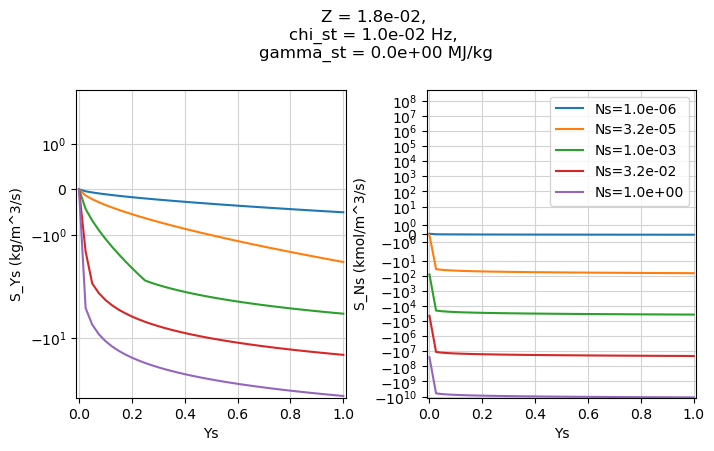

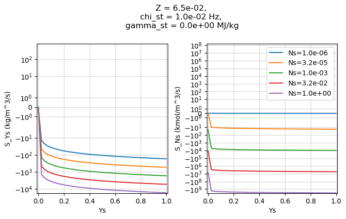

We add a scalar variance dimension to our flamelet libraries using
``apply_mixing_model`` with the presumed clipped-Gaussian PDF and remove
any properties not needed for integrating the soot equations. Now our
libraries contain all the flamelet variables from the ‘original’
simulation plotted above.

.. code:: ipython3

    props_keep = ['density', 'nucl_C2H2', 'coag', 'surf_C2H2', 'surf_OH', 'surf_O2'] # properties needed for soot transport equations
    
    for prop in lib_p0.props:
        if prop not in props_keep:
            lib_p0.remove(prop)
    
    for prop in lib_p1.props:
        if prop not in props_keep:
            lib_p1.remove(prop)
    
    ### convolution integrals
    varvals = np.linspace(sv_sim(t_sim).min(), sv_sim(t_sim).max(), 4)
    tlib_p0 = apply_mixing_model(lib_p0, {'mixture_fraction':PDFSpec('clipgauss', scaled_variance_values=varvals)})
    tlib_p1 = apply_mixing_model(lib_p1, {'mixture_fraction':PDFSpec('clipgauss', scaled_variance_values=varvals)})

We can compose source terms given a mass fraction, number density, and
tabulated coefficients following the equations in our soot
documentation. The ``get_soot_source_term_evaluator`` function will
detect which soot model was used to generate a library based on the
species/coefficients present and return the appropriate function for
evaluating the source terms for soot mass fraction and soot number
density. Similarly, ``get_soot_source_term_jacobian_evaluator`` returns
the Jacobian evaluator. If verbose is True, the soot model detected on
the library will be printed. Below, we find the “aksit-moss” model and
save off the appropriate functions.

When evaluated, the source term function will return a dictionary of the
source terms for the soot number density (‘S_Ns’) and soot mass fraction
(‘S_Ys’) along with various contributions to those source terms. The
‘input_mult_dict’ argument can be used to set multipliers for any of the
source term coefficients on a library. For example, passing
{‘surf_c2h2’:2} will double the surface growth coefficient for acetylene
before evaluating the source terms. More details on the supported
soot_src\_… functions can be found in the documentation.

.. code:: ipython3

    src_eval, soot_props = get_soot_source_term_evaluator(tlib_p0)
    jac_eval, _ = get_soot_source_term_jacobian_evaluator(tlib_p0)

.. parsed-literal::

    Detected soot model "aksit-moss" in the table.
    Detected soot model "aksit-moss" in the table.

Next we need to create functions for evaluating :math:`K(\bar{\phi}_o)`
and :math:`J(\bar{\phi}_o)` in our transport equations. This involves
evaluating the source term coefficients at the appropriate flamelet
variables then evaluating the source terms and Jacobian at those
coefficients and solution variables :math:`\bar{\phi}_o`. In order to
simplify this evaluation during integration of the soot equations, we
build interpolants over the residence time.

.. code:: ipython3

    def get_interps(library, mult_dict=None):
        inputs = [z_sim(t_sim), xst_sim(t_sim), gst_sim(t_sim), sv_sim(t_sim)] # flamelet variables from 'original' simulation
        inputs_arr = np.array(inputs).T
    
        ### create table for evaluating source coeffs with flamelet variables
        tbl = StateTable()
        input_names = []
        input_mesh = []
        slice_list = []
        for i,d in enumerate(library.dims):
            input_names.append(d.name)
            vals = d.values
            if 'enthalpy_defect' in input_names[-1]:
                vals = vals[::-1]
                slice_list.append(slice(None, None, -1))
            else:
                slice_list.append(slice(None, None, None))
            input_mesh.append(vals)
    
        for prop in library.props:
            dval = library[prop].copy()
            dval = dval[tuple(slice_list)]
            interp = LagrangeInterpolant4D(3, 
                                        *input_mesh,
                                        dval.ravel(order='F'), 
                                        True)
            tbl.add_entry(prop, interp, input_names)
    
        ### at each residence time evaluate the source terms and Jacobian
        soot_coeffs = dict()
        for prop in soot_props:
            soot_coeffs[prop] = tbl.query(prop, *inputs)
        rho = tbl.query('density', *inputs)
    
        srcs = src_eval(Ns_sim, Ys_sim, **soot_coeffs, input_mult_dict=mult_dict)
        K_Ns = srcs['S_Ns']/rho
        K_Ys = srcs['S_Ys']/rho
    
        jac = jac_eval(Ns_sim, Ys_sim, **soot_coeffs, input_mult_dict=mult_dict)
        J_NN = jac['dSNs_dNs']/rho
        J_NY = jac['dSNs_dYs']/rho
        J_YN = jac['dSYs_dNs']/rho
        J_YY = jac['dSYs_dYs']/rho
    
        ### save off interpolants for source term, Jacobian, and density over the residence time
        kind = 1
        K_Ns_interp = interp1d(t_sim, K_Ns, kind=kind)
        K_Ys_interp = interp1d(t_sim, K_Ys, kind=kind)
        J_NN_interp = interp1d(t_sim, J_NN, kind=kind)
        J_NY_interp = interp1d(t_sim, J_NY, kind=kind)
        J_YN_interp = interp1d(t_sim, J_YN, kind=kind)
        J_YY_interp = interp1d(t_sim, J_YY, kind=kind)
        rho_interp = interp1d(t_sim, rho, kind=kind)
    
        return {'K_Ns':K_Ns_interp, 'K_Ys':K_Ys_interp,
                'J_NN':J_NN_interp, 'J_NY':J_NY_interp,
                'J_YN':J_YN_interp, 'J_YY':J_YY_interp,
                'rho':rho_interp, 'table':tbl}

We will compare solutions for 3 different flamelet models:

1. 100% soot leakage

2. 1% soot leakage

3. 1% soot leakage including a multiplier of 2 on the acetylene surface
   growth coefficient

We expect these models to show increasing soot levels moving down our
list.

.. code:: ipython3

    ### dictionary for saving off solutions for the different models
    sol_dict = {
                '100% leakage':            {'interps':get_interps(tlib_p0),                   'color':'k'},
                '1% leakage':              {'interps':get_interps(tlib_p1),                   'color':'r'},
                '1% leakage, 2X surf_c2h2':{'interps':get_interps(tlib_p1, {'surf_c2h2':2.}), 'color':'c'}
               }

Now we can use Spitfire’s ``odesolve`` to integrate the two soot
equations. We define ``ode_rhs`` to compute

:math:`D_t\bar{\phi} = K(\bar{\phi}_o(t)) - K_o(\bar{\phi}_o(t)) + D_t\bar{\phi}_o(t) + J(\bar{\phi}_o(t))(\bar{\phi} - \bar{\phi}_o(t))`

which, using our interpolants created above, represented with :math:`I`,
or the known data/functions from simulation, represented with :math:`F`,
looks like

:math:`D_t\bar{\phi} = I_K(t) - F_{K_o}(t) + F_{D_t\bar{\phi}_o}(t) + I_J(t)(\bar{\phi} - F_{\bar{\phi}_o}(t))`.

We also define a postprocessing function ``clip`` to ensure the solution
variables remain positive and bounded. The solutions for :math:`N_s` and
:math:`Y_s` over time get saved for each of the models in our solution
dictionary created above.

.. code:: ipython3

    def clip(t,q,r,nt):
        soot_number_density = np.min([np.max([q[0], 1.e-16]), 1.e6])
        soot_mass_fraction  = np.min([np.max([q[1], 1.e-16]), 1.])
        return np.array([soot_number_density, soot_mass_fraction])
    
    for sol in sol_dict:
        def ode_rhs(t, phi):
            clipped = clip(None, phi, None, None)
            Ns = clipped[0]
            Ys = clipped[1]
            Ns_sim = ns_sim(t)
            Ys_sim = ys_sim(t)
            diff_Ns = Ns - Ns_sim
            diff_Ys = Ys - Ys_sim
    
            K_Ns_sim = kns_sim(t)
            K_Ys_sim = kys_sim(t)
            RHS_Ns_sim = rns_sim(t)
            RHS_Ys_sim = rys_sim(t)
    
            K_Ns = sol_dict[sol]['interps']['K_Ns'](t)
            K_Ys = sol_dict[sol]['interps']['K_Ys'](t)
            J_NN = sol_dict[sol]['interps']['J_NN'](t)
            J_NY = sol_dict[sol]['interps']['J_NY'](t)
            J_YN = sol_dict[sol]['interps']['J_YN'](t)
            J_YY = sol_dict[sol]['interps']['J_YY'](t)
    
            rhs_Ns = K_Ns - K_Ns_sim + RHS_Ns_sim + J_NN*diff_Ns + J_NY*diff_Ys
            rhs_Ys = K_Ys - K_Ys_sim + RHS_Ys_sim + J_YN*diff_Ns + J_YY*diff_Ys
            return np.array([rhs_Ns, rhs_Ys])
    
        init = np.array([Ns_sim[0], Ys_sim[0]])
        ts, NsYs = odesolve(ode_rhs, init, save_each_step=True, stop_at_time=t_sim.max(),
                            post_step_callback = clip,
                            step_size=PIController(target_error=1.e-6, first_step=1.e-3, max_step=0.05),
                            maximum_residual=1.e10)
        sol_dict[sol]['t'] = ts
        sol_dict[sol]['Ns'] = NsYs[:,0]
        sol_dict[sol]['Ys'] = NsYs[:,1]

Below we plot the results for soot mass fraction :math:`Y_s` and number
density :math:`N_s` for each of the soot models. As expected, the 1%
leakage model leads to more soot than the 100% leakage since it assumes
lower oxidation rates. We also see how doubling the surface growth
coefficient leads to further increase in soot mass fraction, as
expected. There is little difference among :math:`N_s` for the models.
The only differences come from the contribution of :math:`Y_s` to
:math:`D_t N_s`.

.. code:: ipython3

    fig, ax = plt.subplots(1,2, figsize=(10,4))
    for sol in list(sol_dict.keys())[::-1]:
        ax[0].plot(sol_dict[sol]['t'], sol_dict[sol]['Ys'],'-', linewidth=2, color=sol_dict[sol]['color'], label=sol)
    for sol in sol_dict:
        ax[1].plot(sol_dict[sol]['t'], sol_dict[sol]['Ns'],'-', linewidth=2, color=sol_dict[sol]['color'])
    ax[0].legend()
    for a in ax:
        a.grid(color='lightgray')
        a.set_xlabel('residence time (s)')
    ax[0].set_ylabel('soot mass fraction')
    ax[1].set_ylabel('soot number density')
    plt.show()

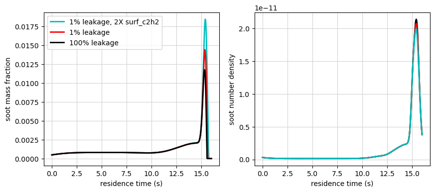

The soot volume fraction is another useful quantity to analyze. This can
be calculated from

:math:`f_v = Y_s \rho / \rho_s`

where the density of soot
:math:`\rho_s = 1800 \ \mathrm{kg}/\mathrm{m}^3`. This is plotted for
the different models below.

.. code:: ipython3

    for sol in list(sol_dict.keys())[::-1]:
        fv_ppm = sol_dict[sol]['Ys'] * sol_dict[sol]['interps']['rho'](sol_dict[sol]['t'])/1800.*1.e6
        plt.plot(sol_dict[sol]['t'], fv_ppm, '-', linewidth=2, color=sol_dict[sol]['color'],  label=sol)
    plt.legend()
    plt.grid(color='lightgray')
    plt.xlabel('residence time (s)')
    plt.ylabel('soot volume fraction (ppm)')
    plt.show()

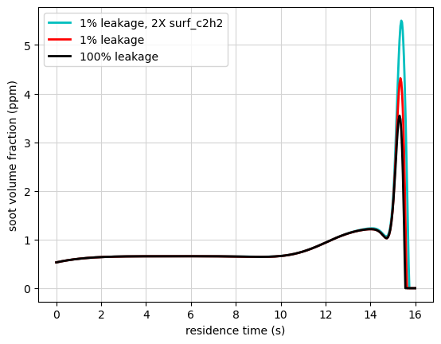

Finally, we can perform a budget analysis on the source term evaluations
for each model. We break each source term down into its components and
see which terms have the largest contributions. We find the surface
growth is the main contributor for the 1% leakage models, with the
multiplier of 2 directly doubling this contribution. The 100% leakage
model has larger oxidation, creating more of a balance between it and
surface growth. The nucleation and coagulation are the same among the
models.

.. code:: ipython3

    for sol in sol_dict:
        tbl = sol_dict[sol]['interps']['table']
        mult_dict = {'surf_c2h2':2.} if '2X' in sol else None
    
        inputs = [z_sim(t_sim), xst_sim(t_sim), gst_sim(t_sim), sv_sim(t_sim)]
        inputs_arr = np.array(inputs).T
    
        nucl_C2H2 = tbl.query('nucl_C2H2', inputs_arr[:,0], inputs_arr[:,1], inputs_arr[:,2], inputs_arr[:,3])
        coag = tbl.query('coag', inputs_arr[:,0], inputs_arr[:,1], inputs_arr[:,2], inputs_arr[:,3])
        surf_C2H2 = tbl.query('surf_C2H2', inputs_arr[:,0], inputs_arr[:,1], inputs_arr[:,2], inputs_arr[:,3])
        surf_O2 = tbl.query('surf_O2', inputs_arr[:,0], inputs_arr[:,1], inputs_arr[:,2], inputs_arr[:,3])
        surf_OH = tbl.query('surf_OH', inputs_arr[:,0], inputs_arr[:,1], inputs_arr[:,2], inputs_arr[:,3])
        rho = tbl.query('density', inputs_arr[:,0], inputs_arr[:,1], inputs_arr[:,2], inputs_arr[:,3])
    
        src_dict = src_eval(Ns_sim, Ys_sim, nucl_C2H2, coag, surf_C2H2, surf_O2, surf_OH, mult_dict)
    
        lw = 1.5
        fig, ax = plt.subplots(1,2,figsize=(12,6))
        ax[0].plot(t_sim, src_dict['S_Ns'], 'k-', linewidth=lw+1, label='S_Ns')
        ax[0].plot(t_sim, src_dict['S_Ns_nucl'], linewidth=lw, label='nucl')
        ax[0].plot(t_sim, src_dict['S_Ns_coag'], linewidth=lw, label='coag')
        ax[0].legend()
        ax[0].set_xlabel('residence time (s)')
        ax[0].set_ylabel('Ns source components')
        ax[0].grid(color='lightgray')
        ax[0].set_yscale('symlog', linthresh=1.e-11)
        ax[0].set_ylim([-2.e-9, 2.e-9])
    
        ax[1].plot(t_sim, src_dict['S_Ys'], 'k-', linewidth=lw+1, label='S_Ys')
        ax[1].plot(t_sim, src_dict['S_Ys_nucl'], linewidth=lw, label='nucl')
        ax[1].plot(t_sim, src_dict['S_Ys_c2h2'], linewidth=lw, label='surf_c2h2')
        ax[1].plot(t_sim, src_dict['S_Ys_o2'], linewidth=lw, label='surf_o2')
        ax[1].plot(t_sim, src_dict['S_Ys_oh'], linewidth=lw, label='surf_oh')
        ax[1].set_yscale('symlog', linthresh=1.e-8)
        ax[1].legend()
        ax[1].set_xlabel('residence time (s)')
        ax[1].set_ylabel('Ys source components')
        ax[1].grid(color='lightgray')
        ax[1].set_ylim([-1.e-1, 1.e-1])
    
        plt.suptitle(sol)
        plt.show()

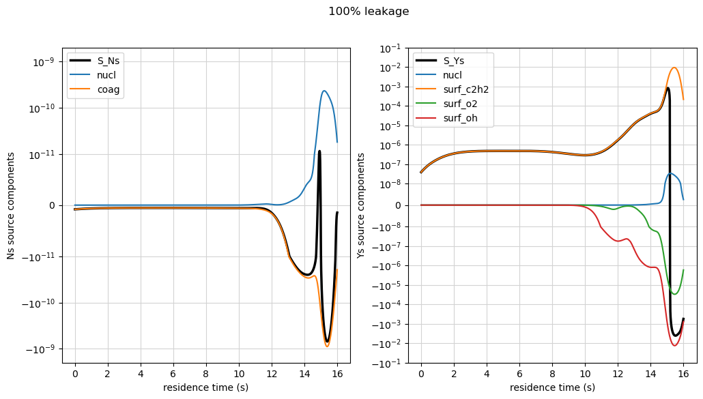

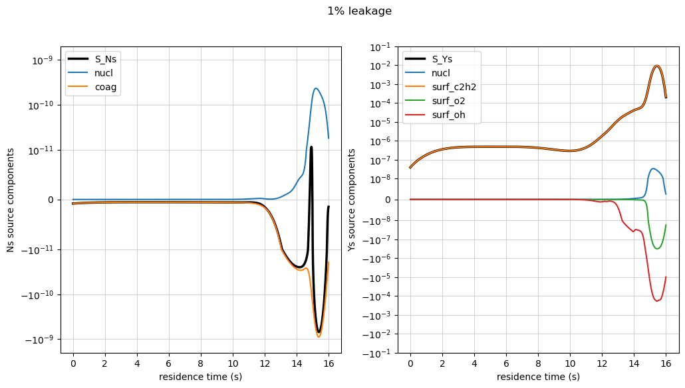

